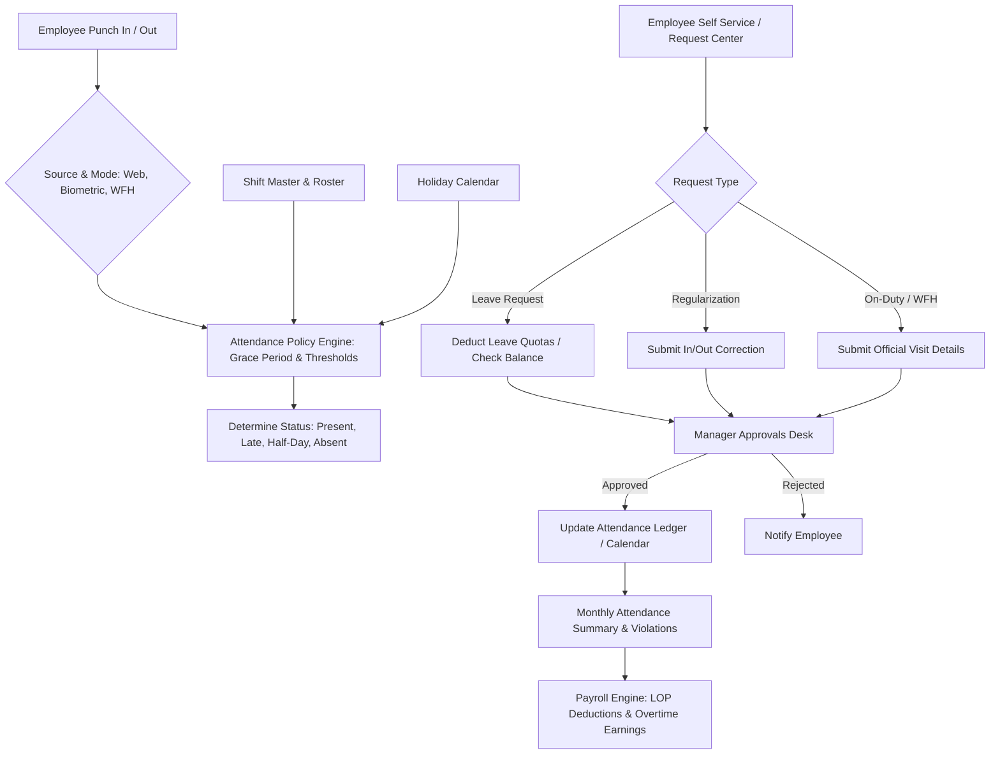
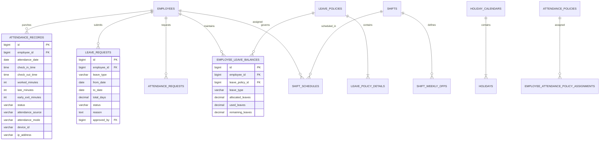
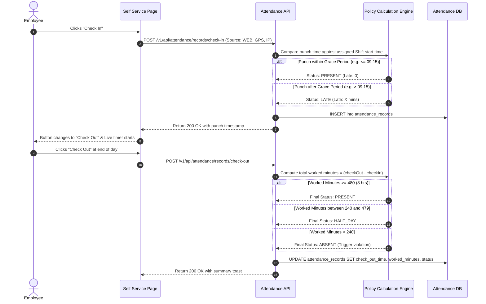
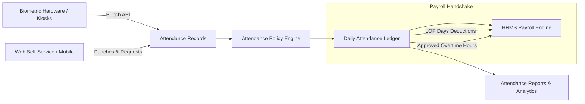

# ATTENDANCE & LEAVE MANAGEMENT MODULE
## Knowledge Transfer (KT) Document

**Version:** 1.0.0  
**Prepared Date:** October 22, 2026  
**Application:** MyTrade ERP Platform (`mytrading-ui`)  
**Module Owner:** Attendance, Leave & Workforce Operations Engineering Team  

---

## TABLE OF CONTENTS
1. [Attendance Module Overview](#1-attendance-module-overview)
   - 1.1 What the Attendance Module Does
   - 1.2 Purpose of the Module
   - 1.3 Main Users & Roles
   - 1.4 Major Business Areas & How They Connect
   - 1.5 High-Level Architecture & Workflow
   - 1.6 Project Navigation Structure
2. [Attendance Pages & Screens](#2-attendance-pages--screens)
3. [Module-Wise Documentation](#3-module-wise-documentation)
   - 3.1 Employee Self-Service (Live Web Clock, 1-Click Punch, Monthly Grid, Quota Popover)
   - 3.2 Unified Request Center (Leaves, Regularizations, On-Duty, WFH Hub)
   - 3.3 Approvals Desk & Manager Dashboard (Pending Approvals Queues & Adjustments)
   - 3.4 Attendance Tracking & Calendar Inspection (Daily Shift & Punch Audit)
   - 3.5 Shift & Roster Management (Shift Definitions, Weekly Offs, Rotational Rosters)
   - 3.6 Holiday Calendar Management (National, State, Festival & Optional Calendars)
   - 3.7 Attendance Reports & Workforce Analytics (Daily, Monthly, Late & Missing Punch)
   - 3.8 Attendance Policy Master & Assignment (Full-Day, Half-Day, Grace Periods & Overtime Thresholds)
   - 3.9 Leave Policy Master & Balance Allocation (Quota Rules, Carry-Forward & Accruals)
   - 3.10 Attendance Punch Console & Device Simulation (Terminals, Geolocation, IP & Enums)
   - 3.11 Overtime Rules & Entries (Multipliers, Weekend Rules & Overtime Approvals)
   - 3.12 Attendance Violations & Regularization Approvals (Exceptions & Discipline)
   - 3.13 Remote Attendance & WFH Logs (IP Tracking, Geofencing & Payroll Sync)
   - 3.14 Timesheet Management (Interactive Batch Regularization Log)
   - 3.15 Notifications & Alert Center (Multi-Channel Alerts & Priority Triggers)
   - 3.16 Attendance-to-Payroll Bridge (Worked Hours, LOP Days & Payroll Components)
4. [API & Backend KT](#4-api--backend-kt)
5. [Database & Data Model](#5-database--data-model)
6. [Important Business Workflows](#6-important-business-workflows)
7. [Role & Permission Model](#7-role--permission-model)
8. [Frontend Implementation](#8-frontend-implementation)
9. [Backend Implementation & Architecture](#9-backend-implementation--architecture)
10. [Integrations & Dependencies](#10-integrations--dependencies)
11. [Configuration & Environment Variables](#11-configuration--environment-variables)
12. [Validations & Business Rules](#12-validations--business-rules)
13. [Error Handling & Common Issues](#13-error-handling--common-issues)
14. [Testing Guide & QA Checklist](#14-testing-guide--qa-checklist)
15. [Deployment & Running Locally](#15-deployment--running-locally)
16. [Troubleshooting Guide](#16-troubleshooting-guide)
17. [Known Gaps & Technical Debt](#17-known-gaps--technical-debt)
18. [Quick KT Summary: "If You Need to Change X, Go Here"](#18-quick-kt-summary-if-you-need-to-change-x-go-here)
19. [Attendance Module Map](#19-attendance-module-map)
- [Document Summary](#document-summary)
- [Known Limitations](#known-limitations)
- [Open Questions](#open-questions)
- [Recommended Next Steps](#recommended-next-steps)

---

## 1. ATTENDANCE MODULE OVERVIEW

### 1.1 What the Attendance Module Does
The Attendance & Leave Management Module is the real-time operational engine of MyTrade ERP. It tracks daily employee time, physical and remote check-ins/check-outs, biometric device logs, shift schedules, rotational rosters, holiday calendars, paid time off (PTO), attendance regularization, on-duty field visits, work-from-home requests, and overtime hours. It acts as the single source of truth for all employee work durations, Feeding verified presence, overtime, and Loss of Pay (LOP) calculations directly into the monthly Payroll Engine.

### 1.2 Purpose of the Module
The purpose of the Attendance module is to:
- Capture accurate daily check-in and check-out punches via Web Self-Service, Mobile GPS, Biometric hardware, or WFH logs.
- Enforce organizational attendance policies (grace periods, late marks, early exits, half-day, and minimum hours).
- Automate leave quotas, balances, annual accruals, carry-forwards, and approval workflows.
- Provide unified request centers for employees to request leaves, regularize missed punches, register on-duty visits, and apply for remote work.
- Provide managers with an Approvals Desk to review, approve, reject, or adjust employee attendance and leave requests.
- Organize complex work shifts (day, evening, rotational, night shifts) and generate employee rosters.
- Generate organizational holiday calendars with optional/festival holiday support across locations.
- Calculate exact worked minutes, late minutes, overtime hours, and absent/LOP days for seamless monthly payroll processing.

### 1.3 Main Users & Roles
| Role | Responsibility | Scope in Attendance Module |
| :--- | :--- | :--- |
| **SUPER_ADMIN** | System Owner & Enterprise HR Lead | Full system access across all policies, shift rules, manual overrides, system-wide leave balance adjustments, and audit logs. |
| **ADMIN / HR Admin** | HR Operations Head & Attendance Manager | Configuring attendance & leave policies, holiday calendars, shift rosters, auditing attendance reports, managing department schedules, and exporting compliance data. |
| **MANAGER / Approver** | Team Lead & Department Head | Reviewing pending leaves, regularization requests, on-duty visits, overtime entries, inspecting team calendar tracking, and posting leave adjustments. |
| **USER / EMPLOYEE** | Regular Organization Employee | Self-service web check-in/out, live personal clock, viewing remaining leave quotas, applying for leave, regularization, WFH, and viewing personal attendance history. |

### 1.4 Major Business Areas & How They Connect
The Attendance module is organized into five operational areas:
1. **Daily Operations & Self-Service:** Live Web Clock, 1-Click Check-in/Check-out, Personal Monthly Calendar, Leave Quota Popover, and Unified Request Center.
2. **Approvals & Supervision:** Manager Approvals Desk with dedicated queues (Leaves, Regularizations, On-Duty, Adjustments), Status Summary Analytics, and Team Calendar Tracking.
3. **Scheduling & Shifts:** Unified Shift Master (working hours, break rules, night shifts, weekly offs) and Employee Shift Rostering (rotational schedules across dates).
4. **Policy & Master Setup:** Organizational Attendance Policy Master (grace minutes, half-day thresholds, late limits), Leave Policy Master (annual quotas, carry-forward, encashment), and Multi-Year Holiday Calendars.
5. **Intelligence & Reports:** Organization-wide Daily Attendance, Monthly Summary, Late Arrivals Analysis, Missing Punch Logs, and Violation Tracking linked to Payroll components.

### 1.5 High-Level Architecture & Workflow


### 1.6 Project Navigation Structure
In the application sidebar (`src/layout/AppSidebar.tsx`), Attendance is exposed as a primary navigation category with direct sub-links and role-restricted items:
```
Attendance
 ├── Daily Operations & Self-Service
 │    ├── Employee Self Service (/att_selfService)
 │    ├── Request Center (/att_requestCenter)
 │    └── Attendance Tracking (/att_attendanceTracking)
 ├── Approvals & Supervision
 │    └── Approvals Desk (/att_leaveManagerDashboard) [SUPER_ADMIN, ADMIN, MANAGER]
 ├── Scheduling & Shifts
 │    ├── Shift & Roster (/att_shiftSchedule) [SUPER_ADMIN, ADMIN, MANAGER]
 │    └── Holiday Calendar (/att_holidayCalendar)
 ├── Intelligence & Reports
 │    └── Attendance Reports (/att_reports)
 └── Policy & Master Setup
      ├── Attendance Policy (/att_attendancePolicy) [SUPER_ADMIN, ADMIN]
      └── Leave Policy Master (/att_leavePolicy) [SUPER_ADMIN, ADMIN]
```

*(Supporting standalone routes accessible via system redirects or direct URLs: `/attendance_dashboard`, `/att_punch`, `/att_attendanceRecord`, `/att_attendanceViolation`, `/att_overtimeRule`, `/att_overtimeEntry`, `/att_remoteAttendanceLog`, `/att_workFromHomeRequests`, `/att_timesheetManagement`, `/att_leaveBalance`, `/att_leaveType`, `/att_leaveRequest`, `/notifications`)*.

---

## 2. ATTENDANCE PAGES & SCREENS

The following table comprehensively maps every Attendance page across the entire codebase, including its route, purpose, target roles, primary APIs, and integration status:

| Page | Route | Purpose | Role | Main APIs | Related Modules | Status / Note |
| :--- | :--- | :--- | :--- | :--- | :--- | :--- |
| **Employee Self Service** | `/att_selfService` *(alias `/att_leaveDashboard`)* | Employee personal portal: live ticking clock, 1-click web punch in/out, dynamic employee profile resolver, monthly visual attendance grid, leave quota balance popover, and quick leave modal | `ALL` (Self-Service) | `POST /v1/api/attendance/records/check-in`<br>`POST /v1/api/attendance/records/check-out`<br>`GET /v1/api/attendance/records/my-calendar/{empId}`<br>`GET /v1/api/attendance/leave-requests/employee/{empId}`<br>`GET /v1/api/attendance/holiday-calendars/1/holidays`<br>`GET /v1/api/attendance/employee-leave-balances/{empId}`<br>`GET /v1/api/attendance/leave-policies`<br>`POST /v1/api/attendance/employee-leave-balances/assign-policy` | Request Center, Tracking, Holiday Calendar | **[PRIMARY NAV]**<br>Interactive personal hub with auto policy recovery |
| **Unified Request Center** | `/att_requestCenter` *(alias `/att_unifiedRequests`)* | Unified 4-in-1 request submission and tracking hub: Leaves, Regularizations, On-Duty Visits, and Work From Home with automatic quota validation, balance auto-assignment retry, and cancellation | `ALL` (Self-Service) | `GET /v1/api/payroll/employee/all`<br>`GET /v1/api/attendance/leave-types`<br>`GET /v1/api/attendance/leave-requests`<br>`GET /v1/api/attendance/requests/my/{empId}`<br>`GET /v1/api/attendance/employee-leave-balances`<br>`POST /v1/api/attendance/leave-requests`<br>`POST /v1/api/attendance/requests`<br>`POST /v1/api/attendance/leave-requests/{id}/cancel`<br>`POST /v1/api/attendance/requests/{id}/cancel` | Self Service, Approvals Desk, Leave Policy | **[PRIMARY NAV]**<br>Tabbed interface with drawer inspect |
| **Approvals Desk & Manager Dashboard** | `/att_leaveManagerDashboard` *(redirects from `/att_attendanceApproval`, `/att_onDutyApproval`, `/att_regularizationApproval`)* | Executive supervisor console: live KPI cards, ApexCharts attendance analytics, pending approval queues for Leaves, Regularizations, On-Duty, and manual Leave Adjustment modal | `SUPER_ADMIN`, `ADMIN`, `MANAGER` | `GET /v1/api/attendance/leave-dashboard/status-summary`<br>`GET /v1/api/attendance/manager-leave-dashboard/{empId}`<br>`GET /v1/api/attendance/leave-approvals/pending`<br>`GET /v1/api/attendance/regularization/pending`<br>`GET /v1/api/attendance/attendance-approvals/pending`<br>`PUT /v1/api/attendance/requests/{id}/{action}`<br>`POST /v1/api/attendance/requests/{id}/{action}`<br>`GET /v1/api/attendance/leave-adjustments/{empId}`<br>`POST /v1/api/attendance/leave-adjustments` | Request Center, Attendance Tracking | **[PRIMARY NAV]**<br>Centralized manager workflow hub |
| **Attendance Tracking** | `/att_attendanceTracking` | Visual monthly calendar inspection for any employee or department; daily audit drawer with shift, in/out punches, worked minutes, late/early flags, and Excel/PDF export | `ALL` (Scoped: Self / Manager / Admin) | `GET /v1/api/attendance/records/my-calendar/{empId}`<br>`GET /v1/api/payroll/employee/all` | Self Service, Shift Schedule, Reports | **[PRIMARY NAV]**<br>Rich calendar with day inspection |
| **Shift & Roster Management** | `/att_shiftSchedule` *(alias `/att_shift`)* | Tabbed workspace combining Shift Definitions (working hours, breaks, night shifts, weekly offs) and Employee Rotational Roster assignments with date range pickers | `SUPER_ADMIN`, `ADMIN`, `MANAGER` | `GET /v1/api/attendance/shifts`<br>`POST /v1/api/attendance/shifts`<br>`PUT /v1/api/attendance/shifts/{id}`<br>`GET /v1/api/attendance/shifts/{id}/weekly-offs`<br>`POST /v1/api/attendance/shifts/{id}/weekly-offs`<br>`GET /v1/api/attendance/shiftShedules/assignments`<br>`POST /v1/api/attendance/shiftShedules/assign` | Attendance Policy, Tracking, Self Service | **[PRIMARY NAV]**<br>Wraps `UnifiedShiftManagementPage` |
| **Holiday Calendar** | `/att_holidayCalendar` | Multi-year corporate holiday calendar management: National, State, Festival, and Optional holidays, duplicate validation, copy calendar, and export | `ALL` (Read) / `ADMIN` (Write) | `GET /v1/api/attendance/holiday-calendars`<br>`POST /v1/api/attendance/holiday-calendars`<br>`PUT /v1/api/attendance/holiday-calendars/{id}`<br>`DELETE /v1/api/attendance/holiday-calendars/{id}`<br>`GET /v1/api/attendance/holiday-calendars/{id}/holidays`<br>`POST /v1/api/attendance/holiday-calendars/{id}/holidays` | Tracking, Self Service, Policy | **[PRIMARY NAV]**<br>Interactive holiday master |
| **Attendance Reports** | `/att_reports` | Organization workforce analytics: Daily Attendance, Monthly Summaries, Late Arrivals, Missing Punches, Department distribution tables, and Excel export | `ADMIN`, `SUPER_ADMIN`, `HR` | `GET /v1/api/attendance/dashboard`<br>`GET /v1/api/attendance/reports/daily`<br>`GET /v1/api/attendance/reports/monthly`<br>`GET /v1/api/attendance/reports/late-arrivals`<br>`GET /v1/api/attendance/reports/missing-punch` | Tracking, Approvals Desk, Payroll Engine | **[PRIMARY NAV]**<br>Tabbed report engine |
| **Attendance Policy Master** | `/att_attendancePolicy` | Organization attendance rules master: standard work minutes (full/half day), grace time, late marks, early exits, overtime trigger, and employee policy assignments | `SUPER_ADMIN`, `ADMIN` | `GET /v1/api/attendance/attendance-policies`<br>`POST /v1/api/attendance/attendance-policies`<br>`PUT /v1/api/attendance/attendance-policies/{id}`<br>`GET /v1/api/attendance/employee-attendance-policy-assignments`<br>`POST /v1/api/attendance/employee-attendance-policy-assignments` | Tracking, Self Service, Punch Console | **[PRIMARY NAV]**<br>Core attendance compliance rules |
| **Leave Policy Master** | `/att_leavePolicy` | Annual leave rules master: Casual/Sick/Earned quotas, financial year validity, carry-forward caps, negative balances, and batch policy allocation | `SUPER_ADMIN`, `ADMIN` | `GET /v1/api/attendance/leave-policies`<br>`POST /v1/api/attendance/leave-policies`<br>`PUT /v1/api/attendance/leave-policies/{id}`<br>`DELETE /v1/api/attendance/leave-policies/{id}`<br>`POST /v1/api/attendance/employee-leave-balances/assign-policy` | Request Center, Self Service, Leave Balance | **[PRIMARY NAV]**<br>Core leave entitlement rules |
| **Attendance Punch Console** | `/att_punch` | Virtual punch terminal simulator: device ID, geofencing (latitude/longitude), IP address, Attendance Source (WEB, BIOMETRIC, MOBILE, MANUAL), and Mode (OFFICE, WFH, ON_DUTY) | `SUPER_ADMIN`, `ADMIN`, `EMPLOYEE` | `POST /v1/api/attendance/records/check-in`<br>`POST /v1/api/attendance/records/check-out`<br>`GET /v1/api/attendance/enums?type=attendance_sources`<br>`GET /v1/api/attendance/enums?type=attendance_modes` | Tracking, Self Service, Remote Log | **[SUPPORTING ROUTE]**<br>Hardware simulator & terminal console |
| **Attendance Records Ledger** | `/att_attendanceRecord` | Master raw punch ledger: displays date, employee, check-in, check-out, total hours, late flag, half-day, absent flag, and manual record creation | `ADMIN`, `SUPER_ADMIN` | `GET /v1/api/attendance/records`<br>`POST /v1/api/attendance/records`<br>`PUT /v1/api/attendance/records/{id}`<br>`DELETE /v1/api/attendance/records/{id}` | Tracking, Reports, Payroll | **[SUPPORTING ROUTE]**<br>Raw data ledger |
| **Attendance Violations** | `/att_attendanceViolation` | Exceptions & disciplinary console: tracks late arrivals, early exits, missing check-ins/check-outs, unauthorized absences, and shift mismatches | `ADMIN`, `SUPER_ADMIN`, `MANAGER` | `GET /v1/api/attendance/violations`<br>`POST /v1/api/attendance/violations`<br>`PUT /v1/api/attendance/violations/{id}/resolve` | Reports, Approvals Desk | **[SUPPORTING ROUTE]**<br>Disciplinary exception log |
| **Overtime Rules & Entries** | `/att_overtimeRule` & `/att_overtimeEntry` | Configures overtime compensation multipliers (weekend/holiday 1.5x-2.0x, minimum duration) and tracks employee overtime logs with approval states | `ADMIN`, `SUPER_ADMIN`, `MANAGER` | `GET /v1/api/attendance/overtime-rules`<br>`POST /v1/api/attendance/overtime-rules`<br>`GET /v1/api/attendance/overtime`<br>`POST /v1/api/attendance/overtime` | Payroll, Tracking, Approvals Desk | **[SUPPORTING ROUTE]**<br>Overtime compensation subsystem |
| **Remote Attendance & WFH Logs** | `/att_remoteAttendanceLog` & `/att_workFromHomeRequests` | Tracks remote clock-ins, IP addresses, geolocations, devices, sync status with payroll, and dedicated WFH requests | `ALL` / `ADMIN` | `GET /v1/api/attendance/remote-attendance`<br>`POST /v1/api/attendance/remote-attendance`<br>`GET /v1/api/attendance/requests/my/{empId}` | Request Center, Tracking | **[SUPPORTING ROUTE]**<br>Remote workforce subsystem |
| **Timesheet Management** | `/att_timesheetManagement` | Visual calendar interface allowing employees to select one or multiple days to batch submit regularization requests for forgot check-in or forgot check-out | `EMPLOYEE`, `USER` | `GET /v1/api/attendance/requests`<br>`POST /v1/api/attendance/requests`<br>`GET /v1/api/payroll/employee/all` | Request Center, Self Service | **[SUPPORTING ROUTE]**<br>Batch calendar regularization tool |
| **Notification Center** | `/notifications` *(alias `/att_notifications`, `/notifications/:id`)* | In-app notification center for attendance, leave approval alerts, overtime notifications, and violation alerts with channel tracking | `ALL` | Stored in `localStorage: attendance-topbar-notifications`<br>`GET /v1/api/attendance/notifications` | AppHeader, Request Center, Approvals Desk | **[SUPPORTING ROUTE]**<br>Multi-channel alert dispatch |
| **Attendance Dashboard** | `/attendance_dashboard` | Executive KPI dashboard: Recharts attendance trends, leave type distribution donuts, and direct sub-navigation cards | `SUPER_ADMIN`, `ADMIN` | Internal component metrics and summary mocks | Reports, Approvals Desk | **[SUPPORTING ROUTE]**<br>Executive overview screen |

---

## 3. MODULE-WISE DOCUMENTATION

### 3.1 Employee Self-Service (Live Web Clock, 1-Click Punch, Monthly Grid, Quota Popover)
1. **Purpose:** The daily digital touchpoint for every employee. Enables employees to check in/out with zero latency, monitor elapsed work hours via a 1-second ticking live clock, view their personal monthly attendance calendar, inspect leave quota balances via an interactive popover, and quickly submit leave applications.
2. **User Flow:**
   - Employee opens `/att_selfService`.
   - The system automatically resolves their employee ID from `localStorage: user` and cross-verifies with `/v1/api/payroll/employee/all`.
   - The top banner displays the employee's name, code, designation, initials avatar, a live ticking clock, and greeting.
   - If not punched in: The large primary button displays **"Check In"** (with green indicator). Employee clicks it → System triggers `POST /v1/api/attendance/records/check-in` with `attendanceSource: "WEB"`.
   - Once checked in: Button transforms to **"Check Out"** (amber/rose indicator) and displays live elapsed hours (e.g., `4h 12m`).
   - Leave Balances Popover: Employee clicks the **"Leave Balance"** badge → An interactive popover displays Casual, Sick, and Earned quotas, used days, and remaining balances, mapped to the organization's active leave policy.
   - Calendar Grid: Displays every day of the month with color-coded status badges: `PRESENT` (green), `ABSENT` (rose), `LATE` (amber), `LEAVE` (purple), `HOLIDAY` (cyan), and `WEEK_OFF` (slate). Employee can click any day to inspect in/out timings or open the full-screen calendar modal.
3. **UI / Pages:** `src/pages/Attendance/EmployeeSelfServicePage.tsx`.
4. **APIs:**
   - `POST /v1/api/attendance/records/check-in`
   - `POST /v1/api/attendance/records/check-out`
   - `GET /v1/api/attendance/records/my-calendar/{employeeId}?year={y}&month={m}`
   - `GET /v1/api/attendance/leave-requests/employee/{employeeId}`
   - `GET /v1/api/attendance/holiday-calendars/1/holidays`
   - `GET /v1/api/attendance/employee-leave-balances/{employeeId}`
   - `GET /v1/api/attendance/leave-policies`
   - `POST /v1/api/attendance/employee-leave-balances/assign-policy`
5. **Request Parameters & Payloads:**
   - **Check-In Payload:**
     ```json
     {
       "employeeId": 12,
       "attendanceSource": "WEB",
       "attendanceMode": "OFFICE",
       "deviceId": "Browser",
       "deviceName": "Employee Self Service Portal",
       "location": "HYD Office",
       "latitude": 17.3850,
       "longitude": 78.4867,
       "ipAddress": "192.168.1.100"
     }
     ```
   - **Check-Out Payload:**
     ```json
     {
       "employeeId": 12,
       "attendanceSource": "WEB",
       "attendanceMode": "OFFICE",
       "deviceId": "Browser",
       "deviceName": "Employee Self Service Portal",
       "location": "HYD Office",
       "latitude": 17.3850,
       "longitude": 78.4867,
       "ipAddress": "192.168.1.100",
       "remarks": "Web checkout from Self Service"
     }
     ```
6. **Response Structure:**
   ```json
   {
     "id": 849,
     "employeeId": 12,
     "punchTime": "2026-10-22T09:04:12",
     "attendanceStatus": "PRESENT",
     "workedMinutes": 0,
     "lateByMinutes": 0,
     "message": "Check-in recorded successfully!"
   }
   ```
7. **Database Entities:** `attendance_records`, `employee_leave_balances`, `leave_policies`, `holiday_calendars`.
8. **Business Rules:**
   - Cannot check in twice on the same day without checking out.
   - If an employee has no leave balances initialized in the database, the page automatically calls `/assign-policy` in the background with the active leave policy ID to prevent application failure.
   - Elapsed work hours calculate dynamically in the browser between `inTime` and the live system clock.
9. **Validations:** Dates must be valid ISO format; punch payload requires non-zero employee ID.
10. **Error Handling:** Graceful fallback to `Promise.allSettled` across calendar, leaves, holidays, and balances so an issue in holidays does not block attendance punches.
11. **Permissions / Roles:** Accessible to all logged-in users (scoped to their own record).
12. **Dependencies:** `lucide-react`, `ToasterService`, `AuthContext`.
13. **Related Modules:** Unified Request Center, Attendance Tracking, Leave Policy Master.

---

### 3.2 Unified Request Center (Leaves, Regularizations, On-Duty, WFH Hub)
1. **Purpose:** Consolidates all four primary employee workflow requests into a single, high-productivity screen with URL query synchronization (`?tab=leaves|regularizations|onDuty|wfh`), live status badges, quota consumption calculation, and self-cancellation.
2. **User Flow:**
   - Employee navigates to `/att_requestCenter`.
   - **Tab 1: Leave Requests:** Employee selects Leave Type (Casual, Sick, Earned), specifies Date Range (`fromDate` to `toDate`), chooses Day Type (Full Day vs Half Day First/Second Half), views auto-calculated total days, enters reason, and clicks **"Submit Leave Request"**.
   - **Tab 2: Attendance Regularization:** Employee specifies date, enters corrected Check-In and Check-Out times, selects Reason Type (`FORGOT_IN`, `FORGOT_OUT`, `DEVICE_ISSUE`, `SYSTEM_GLITCH`), adds remarks, and submits.
   - **Tab 3: On-Duty (OD) Visits:** Employee specifies client name, visit location, official purpose, and check-in/out times.
   - **Tab 4: Work From Home (WFH):** Employee requests remote work approval for specific dates with project deliverable remarks.
   - **Request History Table:** Below the form, the unified table lists all submitted requests with status (`PENDING`, `APPROVED`, `REJECTED`, `CANCELLED`), date range, reason, and an action drawer button.
   - **Cancellation:** Employees can click **"Cancel Request"** on any request that is still in `PENDING` status.
3. **UI / Pages:** `src/pages/Attendance/UnifiedRequestCenterPage.tsx`.
4. **APIs:**
   - `GET /v1/api/payroll/employee/all`
   - `GET /v1/api/attendance/leave-types`
   - `GET /v1/api/attendance/leave-requests`
   - `GET /v1/api/attendance/requests/my/{employeeId}`
   - `GET /v1/api/attendance/employee-leave-balances`
   - `POST /v1/api/attendance/leave-requests`
   - `POST /v1/api/attendance/requests`
   - `POST /v1/api/attendance/leave-requests/{id}/cancel`
   - `POST /v1/api/attendance/requests/{id}/cancel`
5. **Request Parameters & Payloads:**
   - **Leave Request Payload:**
     ```json
     {
       "employeeId": 12,
       "employeeCode": "TEC-EMP-0001",
       "employeeName": "System Admin",
       "leaveType": "CASUAL",
       "fromDate": "2026-10-25",
       "toDate": "2026-10-26",
       "totalDays": 2,
       "reason": "Personal family event"
     }
     ```
   - **Regularization Payload:**
     ```json
     {
       "employeeId": 12,
       "requestDetails": [
         {
           "fromDate": "2026-10-21",
           "toDate": "2026-10-21",
           "shiftDate": "2026-10-21",
           "requestType": "ATTENDANCE_REGULARIZATION",
           "checkInTime": "09:00",
           "checkOutTime": "18:00",
           "shiftInTime": "09:00",
           "shiftOutTime": "18:00",
           "reason": "Forgot to check in",
           "remarks": "Biometric terminal was rebooting"
         }
       ]
     }
     ```
   - **On-Duty Payload:**
     ```json
     {
       "employeeId": 12,
       "requestDetails": [
         {
           "fromDate": "2026-10-24",
           "toDate": "2026-10-24",
           "shiftDate": "2026-10-24",
           "requestType": "ON_DUTY",
           "clientName": "Acme Global Corp",
           "visitLocation": "Bangalore Tech Park",
           "purpose": "Client Architecture Workshop",
           "checkInTime": "09:30",
           "checkOutTime": "17:30",
           "shiftInTime": "09:00",
           "shiftOutTime": "18:00",
           "reason": "Client Visit",
           "remarks": "Customer on-site milestone delivery"
         }
       ]
     }
     ```
6. **Response Structure:** Standard success message or created entity: `{ "id": 142, "status": "PENDING", "message": "Request submitted successfully" }`.
7. **Database Entities:** `leave_requests`, `attendance_requests`, `attendance_request_details`.
8. **Business Rules:**
   - End Date cannot be earlier than Start Date.
   - Half-day requests constrain `totalDays` to `0.5`.
   - Automatic retry: If a leave request fails due to `balance` or `policy` assignment error, the page automatically triggers policy assignment and retries the leave submission seamlessly.
   - Only requests in `PENDING` status can be cancelled by the employee.
9. **Validations:** Required date ranges, non-empty reasons, positive durations.
10. **Error Handling:** Catches API validation messages and renders explicit ToasterService banners.
11. **Permissions / Roles:** Accessible to all logged-in employees.
12. **Dependencies:** `ReusableTable`, `TableToolbar`, `ToasterService`.
13. **Related Modules:** Approvals Desk, Leave Policy Master, Employee Self Service.

---

### 3.3 Approvals Desk & Manager Dashboard (Pending Approvals Queues & Adjustments)
1. **Purpose:** Centralized command center for managers, department heads, and HR admins. Provides executive KPI ribbons, ApexCharts attendance analytics, and dedicated actionable queues for approving/rejecting Leaves, Regularizations, and On-Duty requests, alongside a manual Leave Adjustment modal.
2. **User Flow:**
   - Manager navigates to `/att_leaveManagerDashboard`.
   - Supervisor ribbon displays: Total Employees, Active Count, Employees on Leave Today, Upcoming Leaves this Week, and Total Pending Approvals.
   - Manager selects a tab:
     - **Tab 1: Leave Requests:** Table lists pending leaves with employee name, leave type, date range, total days, reason, and action buttons: **Approve** (green check) or **Reject** (rose cross).
     - **Tab 2: Attendance Regularization:** Table lists missed punch correction requests. Manager inspects proposed check-in/out times vs standard shift times and approves/rejects.
     - **Tab 3: On-Duty Approvals:** Table lists field visit submissions with client name, visit location, and timings.
     - **Tab 4: Leave Adjustments:** Displays audit log of administrative balance overrides. Clicking **"+ Post Leave Adjustment"** opens a modal to credit or debit days (Casual/Sick/Earned) for any employee with mandatory remarks.
3. **UI / Pages:**
   - `src/pages/Attendance/LeaveManagerDashboardPage.tsx`
   - Child components: `AttendanceApprovalRequestPage.tsx`, `AttendanceRegularizationApprovalPage.tsx`, `OnDutyApprovalPage.tsx`.
4. **APIs:**
   - `GET /v1/api/attendance/leave-dashboard/status-summary`
   - `GET /v1/api/attendance/manager-leave-dashboard/{employeeId}`
   - `GET /v1/api/attendance/leave-approvals/pending`
   - `GET /v1/api/attendance/regularization/pending`
   - `GET /v1/api/attendance/attendance-approvals/pending`
   - `PUT /v1/api/attendance/requests/{id}/approve`
   - `PUT /v1/api/attendance/requests/{id}/reject`
   - `GET /v1/api/attendance/leave-adjustments/{employeeId}`
   - `POST /v1/api/attendance/leave-adjustments`
5. **Request Parameters & Payloads:**
   - **Approval / Rejection Payload:**
     ```json
     {
       "remarks": "Approved as per team coverage schedule",
       "approvedBy": 12
     }
     ```
   - **Leave Adjustment Payload:**
     ```json
     {
       "employeeId": 12,
       "leaveType": "CASUAL",
       "adjustmentLeaves": 2,
       "remarks": "Compensatory off granted for weekend production deployment",
       "adjustedBy": "System Admin (SUPER_ADMIN)"
     }
     ```
6. **Response Structure:**
   ```json
   {
     "status": "APPROVED",
     "message": "Leave request approved successfully"
   }
   ```
7. **Database Entities:** `leave_requests`, `attendance_requests`, `leave_adjustments`, `employee_leave_balances`.
8. **Business Rules:**
   - Only `SUPER_ADMIN`, `ADMIN`, or `MANAGER` can approve/reject requests.
   - Approving a leave request immediately debits the employee's `employee_leave_balances` record and marks the day as `LEAVE` on their attendance calendar.
   - Rejecting a leave request restores any provisional quota reservation.
   - Leave adjustments require mandatory remarks for compliance auditing.
9. **Validations:** Remark is mandatory when rejecting or posting an adjustment.
10. **Error Handling:** Candidate endpoint fallbacks (`/v1/api/attendance/leave-adjustments` vs `/leave-adjustments`) with non-blocking error recovery.
11. **Permissions / Roles:** Restricted in sidebar to `SUPER_ADMIN`, `ADMIN`, and `MANAGER`.
12. **Dependencies:** `react-apexcharts`, `ReusableTable`, `ToasterService`.
13. **Related Modules:** Unified Request Center, Attendance Tracking, Leave Policy Master.

---

### 3.4 Attendance Tracking & Calendar Inspection (Daily Shift & Punch Audit)
1. **Purpose:** Interactive organizational attendance inspection portal. Enables HR and Managers to inspect any employee's monthly attendance matrix, audit punch times, verify worked minutes vs required shift hours, inspect late/early exit flags, and export individual or departmental logs to Excel and PDF.
2. **User Flow:**
   - User navigates to `/att_attendanceTracking`.
   - Selects an Employee from the searchable dropdown (defaults to logged-in user or first active employee).
   - Uses navigation arrows (`<`, `>`) to toggle months.
   - Monthly Grid: Renders a 7-column calendar (Sun-Sat) with color-coded daily tiles showing punch-in time, punch-out time, worked duration, and status indicators.
   - Day Audit Drawer: Clicking any day opens a slide-over drawer displaying: Shift Name, Shift Window (e.g. `09:00 - 18:00`), First In, Last Out, Total Worked Hours, Late Minutes, Early Exit Minutes, Overtime Minutes, and Geolocation/Device.
   - Export: User clicks **"Export Excel"** or **"Export PDF"** to download the employee's monthly attendance sheet.
3. **UI / Pages:** `src/pages/Attendance/AttendanceTrackingPage.tsx`.
4. **APIs:**
   - `GET /v1/api/attendance/records/my-calendar/{employeeId}?year={y}&month={m}`
   - `GET /v1/api/payroll/employee/all`
5. **Request Parameters:** Query params: `employeeId`, `year`, `month`.
6. **Response Structure:**
   ```json
   {
     "employeeId": 12,
     "year": 2026,
     "month": 10,
     "days": [
       {
         "date": "2026-10-01",
         "status": "PRESENT",
         "inTime": "2026-10-01T08:58:14",
         "outTime": "2026-10-01T18:04:22",
         "workedMinutes": 546,
         "lateMinutes": 0,
         "earlyExitMinutes": 0,
         "overtimeMinutes": 6,
         "leaveType": null,
         "holidayName": null
       }
     ]
   }
   ```
7. **Database Entities:** `attendance_records`, `shifts`, `shift_schedules`.
8. **Business Rules:**
   - Weekends are identified via assigned shift weekly offs.
   - Holidays are flagged via the active holiday calendar.
   - Status precedence: `HOLIDAY` > `LEAVE` > `PRESENT` > `LATE` > `ABSENT` > `WEEK_OFF`.
9. **Validations:** Employee selection must be a valid registered employee ID.
10. **Error Handling:** Displays empty calendar skeleton with informative prompt if backend returns no records for a given month.
11. **Permissions / Roles:** All users can view their own tracking; Managers/Admins can select other employees.
12. **Dependencies:** `xlsx`, `file-saver`, `jspdf`, `jspdf-autotable`.
13. **Related Modules:** Employee Self Service, Shift & Roster, Attendance Reports.

---

### 3.5 Shift & Roster Management (Shift Definitions, Weekly Offs, Rotational Rosters)
1. **Purpose:** Configures organization work shifts (Day, Evening, Night, Rotational) with flexible break durations, night-shift flags, weekly-off configurations, and schedules employees onto specific shifts across date ranges.
2. **User Flow:**
   - Manager navigates to `/att_shiftSchedule`.
   - **Tab 1: Shift Master (`ShiftPage.tsx`):**
     - Table lists existing shifts (e.g. `General Shift (09:00 - 18:00)`, `Night Shift (21:00 - 06:00)`).
     - Clicking **"+ Create Shift"** opens a modal to specify: Shift Code, Shift Name, Start Time, End Time, Grace Period (mins), Break Duration, Night Shift toggle (handles cross-midnight calculations), and Active flag.
     - Clicking **"Manage Weekly Offs"** allows selecting Saturday/Sunday or alternating weekend rules.
   - **Tab 2: Shift Roster (`EmployeeShiftSchedulePage.tsx`):**
     - Table lists employee shift assignments.
     - Manager clicks **"+ Assign Shift"** → Selects one or multiple employees, chooses the Shift, specifies Start Date and End Date, and submits.
3. **UI / Pages:**
   - `src/pages/Attendance/UnifiedShiftManagementPage.tsx`
   - `src/pages/Attendance/ShiftPage.tsx`
   - `src/pages/Attendance/EmployeeShiftSchedulePage.tsx`
4. **APIs:**
   - `GET /v1/api/attendance/shifts`
   - `POST /v1/api/attendance/shifts`
   - `PUT /v1/api/attendance/shifts/{id}`
   - `GET /v1/api/attendance/shifts/{id}/weekly-offs`
   - `POST /v1/api/attendance/shifts/{id}/weekly-offs`
   - `DELETE /v1/api/attendance/shifts/{shiftId}/weekly-offs/{id}`
   - `GET /v1/api/attendance/shiftShedules/assignments`
   - `POST /v1/api/attendance/shiftShedules/assign`
5. **Request Parameters & Payloads:**
   - **Create Shift Payload:**
     ```json
     {
       "shiftCode": "SH-GEN-01",
       "shiftName": "General Shift",
       "startTime": "09:00",
       "endTime": "18:00",
       "gracePeriodMinutes": 15,
       "breakDurationMinutes": 60,
       "nightShift": false,
       "active": true
     }
     ```
   - **Assign Shift Payload:**
     ```json
     {
       "employeeIds": [12, 14, 18],
       "shiftId": 1,
       "startDate": "2026-11-01",
       "endDate": "2026-11-30"
     }
     ```
6. **Response Structure:** Array of shift objects or created schedule confirmation.
7. **Database Entities:** `shifts`, `shift_weekly_offs`, `shift_schedules`.
8. **Business Rules:**
   - Cross-midnight night shifts (`startTime > endTime`) automatically handle 24-hour rollover logic.
   - Rotational schedules cannot have overlapping date ranges for the same employee.
9. **Validations:** Start time and end time cannot be identical; shift code must be unique.
10. **Error Handling:** Standardized ToasterService notifications with error parsing.
11. **Permissions / Roles:** Restricted to `SUPER_ADMIN`, `ADMIN`, and `MANAGER`.
12. **Dependencies:** `ReusableTable`, `TableToolbar`, `ToasterService`.
13. **Related Modules:** Attendance Tracking, Attendance Policy, Employee Self Service.

---

### 3.6 Holiday Calendar Management (National, State, Festival & Optional Calendars)
1. **Purpose:** Maintains multi-year corporate holiday calendars with classification by National, State, Festival, and Optional holidays. Provides holiday duplication checks, calendar copying across years, and export.
2. **User Flow:**
   - Admin navigates to `/att_holidayCalendar`.
   - Top filter allows selecting Year (`ALL`, `2026`, `2027`) and Status (`ACTIVE`, `INACTIVE`).
   - Table lists holiday calendars (e.g., `HQ Hyderabad Calendar 2026`, `Bangalore Tech Center 2026`) with total holiday counts.
   - **Create Calendar:** Admin clicks **"+ Create Calendar"** → Enters Calendar Code, Calendar Name, Year, Description.
   - **Manage Child Holidays:** Admin clicks **"Manage Holidays"** on any calendar row → Opens modal to add holiday dates, names, holiday type (`NATIONAL`, `STATE`, `FESTIVAL`), optional holiday toggle, and description.
   - **Copy Calendar:** Admin can copy previous year's holidays into a new year calendar with automated date shifting.
3. **UI / Pages:** `src/pages/Attendance/HolidayCalendarPage.tsx`.
4. **APIs:**
   - `GET /v1/api/attendance/holiday-calendars`
   - `POST /v1/api/attendance/holiday-calendars`
   - `PUT /v1/api/attendance/holiday-calendars/{id}`
   - `DELETE /v1/api/attendance/holiday-calendars/{id}`
   - `GET /v1/api/attendance/holiday-calendars/{id}/holidays`
   - `POST /v1/api/attendance/holiday-calendars/{id}/holidays`
5. **Request Parameters & Payloads:**
   - **Create Calendar:**
     ```json
     {
       "calendarCode": "CAL-HYD-2026",
       "calendarName": "Hyderabad HQ Holiday Calendar 2026",
       "description": "Standard corporate holiday schedule for Telangana HQ",
       "calendarYear": 2026,
       "active": true
     }
     ```
   - **Add Child Holidays Payload:**
     ```json
     [
       {
         "holidayDate": "2026-01-26",
         "holidayName": "Republic Day",
         "holidayType": "NATIONAL",
         "optionalHoliday": false,
         "description": "National Holiday"
       },
       {
         "holidayDate": "2026-08-15",
         "holidayName": "Independence Day",
         "holidayType": "NATIONAL",
         "optionalHoliday": false,
         "description": "National Holiday"
       }
     ]
     ```
6. **Response Structure:** Object containing holiday calendar and embedded child holidays list.
7. **Database Entities:** `holiday_calendars`, `holidays`.
8. **Business Rules:**
   - Holidays configured here display as cyan `HOLIDAY` badges in Employee Self Service and Attendance Tracking.
   - When an employee is scheduled on a holiday, worked hours are classified as Overtime if applicable.
9. **Validations:** No duplicate holiday dates within the same calendar year.
10. **Error Handling:** Duplicate date conflict errors handled via dialog alerts.
11. **Permissions / Roles:** Read-only for regular employees; creation/editing restricted to `ADMIN` and `SUPER_ADMIN`.
12. **Dependencies:** `ReusableTable`, `ToasterService`.
13. **Related Modules:** Attendance Tracking, Employee Self Service, Overtime Rules.

---

### 3.7 Attendance Reports & Workforce Analytics (Daily, Monthly, Late & Missing Punch)
1. **Purpose:** Enterprise workforce reporting suite providing high-level executive KPI cards and detailed audit tables across four analytical dimensions: Daily Attendance, Monthly Summary, Late Arrivals, and Missing Punches.
2. **User Flow:**
   - HR Admin navigates to `/att_reports`.
   - Top Executive Dashboard displays 6 KPI metric tiles: Total Employees, Present Today, Absent Today, Late Arrivals Today, On Leave Today, and Missing Punches Today.
   - Admin toggles between 4 report tabs:
     - **Daily Attendance Report:** Shows real-time employee check-in times, check-out times, worked hours, and status.
     - **Monthly Attendance Summary:** Aggregates days present, days absent, late count, half-day count, and LOP days for any selected pay period.
     - **Late Arrivals Report:** Isolates employees who arrived after the policy grace period with exact late minutes and frequency.
     - **Missing Punch Report:** Identifies employees with single check-in punches without corresponding check-outs (flagged for regularization).
   - Export: Admin uses table toolbar export to generate filtered Excel sheets.
3. **UI / Pages:** `src/pages/Attendance/AttendanceReportsPage.tsx`.
4. **APIs:**
   - `GET /v1/api/attendance/dashboard`
   - `GET /v1/api/attendance/reports/daily?date={date}&department={dept}`
   - `GET /v1/api/attendance/reports/monthly?year={y}&month={m}&department={dept}`
   - `GET /v1/api/attendance/reports/late-arrivals?date={date}`
   - `GET /v1/api/attendance/reports/missing-punch?date={date}`
5. **Request Parameters:** Query parameters: `date`, `year`, `month`, `department`.
6. **Response Structure:**
   ```json
   {
     "totalEmployees": 120,
     "presentToday": 108,
     "absentToday": 4,
     "lateArrivalsToday": 5,
     "onLeaveToday": 3,
     "missingPunchesToday": 2,
     "records": [
       {
         "employeeId": 12,
         "employeeName": "System Admin",
         "department": "Engineering",
         "date": "2026-10-22",
         "checkInTime": "09:02:14",
         "checkOutTime": "18:05:00",
         "workedHours": "9h 03m",
         "status": "PRESENT"
       }
     ]
   }
   ```
7. **Database Entities:** `attendance_records`, `employees`, `departments`.
8. **Business Rules:**
   - Missing punches older than 24 hours trigger notifications in the Notification Center for regularization.
   - Monthly summary directly provides the LOP days column required by the Payroll Processing Engine.
9. **Validations:** Date filters must not exceed future dates.
10. **Error Handling:** Fallback empty states when no punches are recorded for a selected holiday/weekend.
11. **Permissions / Roles:** Restricted to `ADMIN`, `SUPER_ADMIN`, and `HR`.
12. **Dependencies:** `ReusableTable`, `TableToolbar`, `ToasterService`.
13. **Related Modules:** Attendance Tracking, Approvals Desk, Payroll Engine.

---

### 3.8 Attendance Policy Master & Assignment (Full-Day, Half-Day, Grace Periods & Overtime Thresholds)
1. **Purpose:** Defines organizational core attendance rules—minimum minutes for full day and half day, grace periods, late mark triggers, early exit rules, overtime initiation thresholds, and assigns these policies to employees.
2. **User Flow:**
   - Admin navigates to `/att_attendancePolicy`.
   - **Tab 1: Policy Assignments:** Displays which policy is mapped to which employee with effective date ranges. Admin can click **"Assign Policy"** to map policies to employees.
   - **Tab 2: Policy Master:** Table displays policy templates (e.g. `Standard HQ Policy`, `Support 24/7 Policy`).
   - Admin clicks **"+ Create Policy"** → Configures:
     - Full Day Minimum Minutes (e.g. `480` = 8 hrs)
     - Half Day Minimum Minutes (e.g. `240` = 4 hrs)
     - Grace Period Minutes (e.g. `15` mins)
     - Late Mark After Minutes (e.g. `15` mins)
     - Early Exit Before Minutes (e.g. `15` mins)
     - Overtime After Minutes (e.g. `30` mins)
     - Max Break Minutes (e.g. `90` mins)
     - Permission Hours Per Month (e.g. `8` hrs)
     - Toggles: Allow WFH, Allow Regularization, Allow On-Duty.
3. **UI / Pages:** `src/pages/Attendance/AttendancePolicyPage.tsx`.
4. **APIs:**
   - `GET /v1/api/attendance/attendance-policies`
   - `POST /v1/api/attendance/attendance-policies`
   - `PUT /v1/api/attendance/attendance-policies/{id}`
   - `GET /v1/api/attendance/employee-attendance-policy-assignments`
   - `POST /v1/api/attendance/employee-attendance-policy-assignments`
5. **Request Parameters & Payloads:**
   ```json
   {
     "policyName": "Standard Corporate HQ Policy",
     "fullDayMinimumMinutes": 480,
     "halfDayMinimumMinutes": 240,
     "gracePeriodMinutes": 15,
     "lateMarkAfterMinutes": 15,
     "earlyExitBeforeMinutes": 15,
     "overtimeAfterMinutes": 30,
     "maxBreakMinutes": 90,
     "allowWorkFromHome": true,
     "allowRegularization": true,
     "allowOnDuty": true,
     "permissionHoursPerMonth": 8,
     "active": true
   }
   ```
6. **Response Structure:** Created policy object with assigned ID.
7. **Database Entities:** `attendance_policies`, `employee_attendance_policy_assignments`.
8. **Business Rules:**
   - Working less than `halfDayMinimumMinutes` classifies attendance as `ABSENT`.
   - Working between `halfDayMinimumMinutes` and `fullDayMinimumMinutes` classifies as `HALF_DAY`.
   - Check-in past `gracePeriodMinutes` marks the record as `LATE`.
9. **Validations:** Minimum full-day minutes must exceed half-day minutes; policy name is mandatory.
10. **Error Handling:** Displays validation errors via ToasterService.
11. **Permissions / Roles:** Restricted to `SUPER_ADMIN` and `ADMIN`.
12. **Dependencies:** `ReusableTable`, `TableToolbar`, `ToasterService`.
13. **Related Modules:** Self Service, Punch Console, Attendance Tracking.

---

### 3.9 Leave Policy Master & Balance Allocation (Quota Rules, Carry-Forward & Accruals)
1. **Purpose:** Establishes organizational leave entitlements across leave categories (Casual, Sick, Earned), defining annual allocation quotas, carry-forward maximums, encashment permissions, negative balance allowances, and batch assigning policies to employees.
2. **User Flow:**
   - Admin navigates to `/att_leavePolicy`.
   - Displays existing leave policies (e.g. `FY 2026 Standard Policy`).
   - Admin clicks **"+ Create Policy"** → Enters Policy Code, Policy Name, Financial Year, Effective From/To dates, Description, and adds child policy details:
     - `CASUAL`: 12 days, Carry forward: No
     - `SICK`: 12 days, Carry forward: No
     - `EARNED`: 18 days, Carry forward: Yes (Max 30 days), Encashment: Yes
   - Admin clicks **"Assign to Employees"** on any policy row → Drawer opens with multi-select employee checklist → Selects employees → Submits.
3. **UI / Pages:** `src/pages/Attendance/LeavePolicyPage.tsx`.
4. **APIs:**
   - `GET /v1/api/attendance/leave-policies`
   - `POST /v1/api/attendance/leave-policies`
   - `PUT /v1/api/attendance/leave-policies/{id}`
   - `DELETE /v1/api/attendance/leave-policies/{id}`
   - `POST /v1/api/attendance/employee-leave-balances/assign-policy`
5. **Request Parameters & Payloads:**
   ```json
   {
     "policyCode": "FY2026_STD",
     "policyName": "FY 2026 Standard Policy",
     "financialYear": 2026,
     "effectiveFrom": "2026-04-01",
     "effectiveTo": "2027-03-31",
     "description": "Standard corporate leave policy for all full-time staff",
     "active": true,
     "policyDetails": [
       {
         "leaveType": "CASUAL",
         "allocatedLeaves": 12,
         "carryForwardAllowed": false,
         "maxCarryForward": 0,
         "allowNegativeBalance": false
       },
       {
         "leaveType": "SICK",
         "allocatedLeaves": 12,
         "carryForwardAllowed": false,
         "maxCarryForward": 0,
         "allowNegativeBalance": false
       },
       {
         "leaveType": "EARNED",
         "allocatedLeaves": 18,
         "carryForwardAllowed": true,
         "maxCarryForward": 30,
         "allowNegativeBalance": false
       }
     ]
   }
   ```
6. **Response Structure:** Leave policy object with populated details array.
7. **Database Entities:** `leave_policies`, `leave_policy_details`, `employee_leave_balances`.
8. **Business Rules:**
   - Assigning a policy to an employee automatically creates or updates their records in `employee_leave_balances`.
   - Used by `UnifiedRequestCenterPage` and `EmployeeSelfServicePage` as the baseline quota for remaining balance calculations.
9. **Validations:** Allocated leaves must be positive integers; financial year must be valid.
10. **Error Handling:** Handled with ToasterService alert banners.
11. **Permissions / Roles:** Restricted to `SUPER_ADMIN` and `ADMIN`.
12. **Dependencies:** `ReusableTable`, `TableToolbar`, `ToasterService`.
13. **Related Modules:** Unified Request Center, Approvals Desk, Self Service.

---

### 3.10 Attendance Punch Console & Device Simulation (Terminals, Geolocation, IP & Enums)
1. **Purpose:** Professional device and punch terminal testing simulator. Emulates physical biometric devices, mobile GPS check-ins, or office kiosk terminals by capturing device IDs, geofencing coordinates (latitude/longitude), IP addresses, and dynamic Attendance Source & Mode enums.
2. **User Flow:**
   - User navigates to `/att_punch`.
   - Terminal Configuration card allows testing different hardware profiles:
     - Device ID (e.g. `BIO-TERM-001`, `MOB-ANDROID-44`)
     - Device Name (e.g. `Reception Biometric Kiosk`)
     - Location (e.g. `Hyderabad Office Tower B`)
     - Latitude & Longitude (supports 1-click **"Get Current GPS"**)
     - Source: `WEB`, `BIOMETRIC`, `MOBILE_APP`, `WFH`, `MANUAL`, `SYSTEM`, `REGULARIZATION`.
     - Mode: `OFFICE`, `WORK_FROM_HOME`, `HYBRID`, `ON_DUTY`, `LEAVE`.
   - Selects Employee → Clicks **"Punch In"** or **"Punch Out"** → Submits payload directly to the check-in endpoint.
3. **UI / Pages:** `src/pages/Attendance/AttendancePunchPage.tsx`.
4. **APIs:**
   - `POST /v1/api/attendance/records/check-in`
   - `POST /v1/api/attendance/records/check-out`
   - `GET /v1/api/attendance/enums?type=attendance_sources`
   - `GET /v1/api/attendance/enums?type=attendance_modes`
5. **Request Parameters & Payloads:** Full `AttendancePayload` with geofencing and device telemetry.
6. **Response Structure:** Punch record with calculated status and timestamp.
7. **Database Entities:** `attendance_records`, `attendance_devices`.
8. **Business Rules:** Validates against assigned geofencing radius if enabled in the organization policy.
9. **Validations:** Valid latitude (-90 to 90) and longitude (-180 to 180).
10. **Error Handling:** Fallback enum list used if `/v1/api/attendance/enums` is unreachable.
11. **Permissions / Roles:** Accessible to `ADMIN`, `SUPER_ADMIN`, and testing engineers.
12. **Dependencies:** `AttendanceEnumService.ts`, `ToasterService`.
13. **Related Modules:** Self Service, Tracking, Remote Attendance Log.

---

### 3.11 Overtime Rules & Entries (Multipliers, Weekend Rules & Overtime Approvals)
1. **Purpose:** Manages overtime compensation policies (e.g., standard weekday 1.25x, weekend 1.5x, holiday 2.0x, minimum overtime duration threshold) and logs employee overtime entries for manager approval.
2. **User Flow:**
   - **Overtime Rules (`/att_overtimeRule`):** Admin defines rules specifying multiplier, whether applicable on weekends/holidays, minimum duration (e.g. `01:00`), and threshold hours.
   - **Overtime Entries (`/att_overtimeEntry`):** Displays logged overtime hours with status (`PENDING`, `APPROVED`, `REJECTED`). Manager can review, approve, or reject overtime submissions.
3. **UI / Pages:**
   - `src/pages/Attendance/OvertimeRulePage.tsx`
   - `src/pages/Attendance/OverTimeEntryPage.tsx`
4. **APIs:**
   - `GET /v1/api/attendance/overtime-rules`
   - `POST /v1/api/attendance/overtime-rules`
   - `GET /v1/api/attendance/overtime`
   - `POST /v1/api/attendance/overtime`
5. **Request Parameters:**
   ```json
   {
     "ruleName": "Weekend Overtime 1.5x",
     "description": "Overtime on scheduled weekly offs",
     "multiplier": 1.5,
     "applicableOnWeekends": true,
     "applicableOnHolidays": false,
     "minDuration": "02:00",
     "thresholdHours": "08:00",
     "priority": 1,
     "active": true
   }
   ```
6. **Response Structure:** Created overtime rule or list of overtime logs.
7. **Database Entities:** `overtime_rules`, `overtime_entries`.
8. **Business Rules:** Approved overtime hours feed directly into the Payroll Engine as variable earning components.
9. **Validations:** Multiplier must be >= 1.0; duration strings must be formatted `HH:mm`.
10. **Error Handling:** Standard ToasterService catch blocks.
11. **Permissions / Roles:** Restricted to `ADMIN`, `SUPER_ADMIN`, and `MANAGER`.
12. **Dependencies:** `ReusableTable`, `StatsCard`, `ConfirmDialog`.
13. **Related Modules:** Payroll Component, Payroll Engine, Approvals Desk.

---

### 3.12 Attendance Violations & Regularization Approvals (Exceptions & Discipline)
1. **Purpose:** Tracks attendance non-compliance—late arrivals exceeding grace limits, early departures, missing check-ins, missing check-outs, unauthorized absences, and shift mismatches. Provides tools for HR and managers to resolve violations or require regularization.
2. **User Flow:**
   - Admin/Manager navigates to `/att_attendanceViolation`.
   - Table lists violations with Employee Name, Date, Violation Type (`LATE_ARRIVAL`, `EARLY_EXIT`, `MISSING_CHECKIN`, `UNAUTHORIZED_ABSENCE`), Duration, and Reason.
   - Admin can click **"Resolve"** once the employee has submitted an approved regularization request.
3. **UI / Pages:** `src/pages/Attendance/AttendanceViolationPage.tsx`.
4. **APIs:**
   - `GET /v1/api/attendance/violations`
   - `POST /v1/api/attendance/violations`
   - `PUT /v1/api/attendance/violations/{id}/resolve`
5. **Request Parameters:** Violation ID and resolution remarks.
6. **Response Structure:** Updated violation record with `resolved: true`.
7. **Database Entities:** `attendance_violations`.
8. **Business Rules:** Persistent unresolved violations can be configured to automatically trigger half-day salary deductions in the Payroll Engine.
9. **Validations:** Violation type must match enum definition.
10. **Error Handling:** ConfirmDialog handles deletion and resolution actions.
11. **Permissions / Roles:** Restricted to `ADMIN`, `SUPER_ADMIN`, and `MANAGER`.
12. **Dependencies:** `ReusableTable`, `StatsCard`, `ConfirmDialog`.
13. **Related Modules:** Attendance Reports, Approvals Desk, Payroll Engine.

---

### 3.13 Remote Attendance & WFH Logs (IP Tracking, Geofencing & Payroll Sync)
1. **Purpose:** Monitors remote employee presence, tracking work IP addresses, client machines, geolocations, and sync status with the payroll engine.
2. **User Flow:**
   - Navigates to `/att_remoteAttendanceLog`.
   - Table lists remote sessions with Employee, Date, Check-In/Out times, IP Address, Location, Device type, and `syncedWithPayroll` boolean badge.
3. **UI / Pages:** `src/pages/Attendance/RemoteAttendanceLogPage.tsx` & `WorkFromHomeRequestPage.tsx`.
4. **APIs:**
   - `GET /v1/api/attendance/remote-attendance`
   - `POST /v1/api/attendance/remote-attendance`
   - `GET /v1/api/attendance/requests/my/{employeeId}`
5. **Database Entities:** `remote_attendance_logs`, `wfh_requests`.
6. **Business Rules:** Unsynced remote logs can be manually audited before monthly payroll freeze.
7. **Permissions / Roles:** Accessible to `ADMIN` and `SUPER_ADMIN`.

---

### 3.14 Timesheet Management (Interactive Batch Regularization Log)
1. **Purpose:** Provides a date-range calendar grid allowing employees to click single or multiple days and generate batch regularization requests for forgotten check-ins or check-outs.
2. **User Flow:**
   - Employee navigates to `/att_timesheetManagement`.
   - Clicks one or multiple dates on the calendar.
   - Dynamic cards generate for each selected date allowing the employee to configure check-in/out times, reason type (`FORGOT_IN`, `FORGOT_OUT`, `BOTH`), and remarks.
   - Submits all regularization requests in a single batch to `POST /v1/api/attendance/requests`.
3. **UI / Pages:** `src/pages/Attendance/TimesheetManagementPage.tsx`.
4. **APIs:** `POST /v1/api/attendance/requests`, `GET /v1/api/payroll/employee/all`.
5. **Permissions / Roles:** Accessible to all logged-in employees.
6. **Related Modules:** Unified Request Center, Approvals Desk.

---

### 3.15 Notifications & Alert Center (Multi-Channel Alerts & Priority Triggers)
1. **Purpose:** Dispatches and manages attendance notifications (approvals, rejections, missing punch alerts, overtime updates) across multiple channels (`IN_APP`, `EMAIL`, `SMS`, `WHATSAPP`, `PUSH`).
2. **User Flow:**
   - Alerts trigger on actions (e.g. Leave submitted → Manager notified; Leave approved → Employee notified).
   - Topbar bell icon displays real-time unread count.
   - Navigating to `/notifications` shows full notification inbox with priority badges (`HIGH`, `MEDIUM`, `LOW`), timestamp formatting ("5 min ago"), and mark-as-read actions.
3. **UI / Pages:**
   - `src/pages/Attendance/NotificationInboxPage.tsx`
   - `src/pages/Attendance/NotificationDetailPage.tsx`
   - `src/pages/Attendance/NotificationPage.tsx`
   - Utility: `src/utils/attendanceNotifications.ts`.
4. **APIs:** `localStorage: attendance-topbar-notifications`, `GET /v1/api/attendance/notifications`.
5. **Permissions / Roles:** Accessible to all users.

---

### 3.16 Attendance-to-Payroll Bridge (Worked Hours, LOP Days & Payroll Components)
1. **Purpose:** Represents the architectural link connecting attendance records with monthly employee compensation. Computes Loss of Pay (LOP) days from unauthorized absences, overtime pay from approved overtime hours, and generates payroll records.
2. **User Flow:**
   - Navigating to `/att_payrollRecord` or `/att_payrollComponent`.
   - Inspects monthly base salary, attendance-driven earnings (Overtime), deductions (LOP days based on daily attendance ledger), and net pay.
3. **UI / Pages:** `src/pages/Attendance/PayrollComponentPage.tsx`, `PayrollRecordPage.tsx`.
4. **APIs:**
   - `GET /v1/api/attendance/payroll-records`
   - `GET /v1/api/attendance/payroll`
5. **Related Modules:** HRMS Payroll Engine (`/payrollEngine`), Salary Records (`/employeeSalary`).

---

## 4. API & BACKEND KT

### 4.1 Attendance API Endpoint Catalog
All Attendance endpoints follow RESTful conventions under `/v1/api/attendance/`:

| Endpoint | Method | Description | Primary Consumer |
| :--- | :--- | :--- | :--- |
| `/v1/api/attendance/records/check-in` | `POST` | Records check-in punch (Web, Biometric, Mobile) | `EmployeeSelfServicePage`, `AttendancePunchPage` |
| `/v1/api/attendance/records/check-out` | `POST` | Records check-out punch and calculates worked minutes | `EmployeeSelfServicePage`, `AttendancePunchPage` |
| `/v1/api/attendance/records/my-calendar/{empId}` | `GET` | Fetches monthly attendance grid for employee | `EmployeeSelfServicePage`, `AttendanceTrackingPage` |
| `/v1/api/attendance/records` | `GET` / `POST` | Master raw punch record management | `AttendanceRecordPage` |
| `/v1/api/attendance/records/{id}` | `PUT` / `DELETE` | Edit or delete individual punch records | `AttendanceRecordPage` |
| `/v1/api/attendance/leave-requests` | `GET` / `POST` | Query all or submit new employee leave request | `UnifiedRequestCenterPage`, `LeaveRequestPage` |
| `/v1/api/attendance/leave-requests/employee/{empId}` | `GET` | Query leave requests for specific employee | `EmployeeSelfServicePage` |
| `/v1/api/attendance/leave-requests/{id}/cancel` | `POST` | Cancels a pending leave request | `UnifiedRequestCenterPage` |
| `/v1/api/attendance/requests` | `POST` | Submits regularization, on-duty, or WFH requests | `UnifiedRequestCenterPage`, `TimesheetManagementPage` |
| `/v1/api/attendance/requests/my/{empId}` | `GET` | Query requests submitted by specific employee | `UnifiedRequestCenterPage`, `WorkFromHomeRequestPage` |
| `/v1/api/attendance/requests/{id}/cancel` | `POST` | Cancels a pending attendance request | `UnifiedRequestCenterPage` |
| `/v1/api/attendance/leave-approvals/pending` | `GET` | Fetches queue of pending leaves awaiting manager approval | `LeaveManagerDashboardPage` |
| `/v1/api/attendance/regularization/pending` | `GET` | Fetches queue of pending regularizations | `LeaveManagerDashboardPage` |
| `/v1/api/attendance/attendance-approvals/pending` | `GET` | Fetches queue of pending on-duty / attendance approvals | `LeaveManagerDashboardPage` |
| `/v1/api/attendance/requests/{id}/approve` | `PUT` / `POST` | Approves leave, regularization, or on-duty request | `LeaveManagerDashboardPage`, `OnDutyApprovalPage` |
| `/v1/api/attendance/requests/{id}/reject` | `PUT` / `POST` | Rejects leave, regularization, or on-duty request | `LeaveManagerDashboardPage`, `OnDutyApprovalPage` |
| `/v1/api/attendance/leave-adjustments/{empId}` | `GET` | Fetches leave adjustment history for employee | `LeaveManagerDashboardPage` |
| `/v1/api/attendance/leave-adjustments` | `POST` | Posts administrative credit/debit adjustment | `LeaveManagerDashboardPage` |
| `/v1/api/attendance/leave-dashboard/status-summary` | `GET` | Fetches live KPI counts (pending, approved, rejected, onLeave) | `LeaveManagerDashboardPage` |
| `/v1/api/attendance/manager-leave-dashboard/{empId}` | `GET` | Fetches supervisor dashboard overview | `LeaveManagerDashboardPage` |
| `/v1/api/attendance/employee-leave-balances` | `GET` | Fetches leave balance records across organization | `UnifiedRequestCenterPage` |
| `/v1/api/attendance/employee-leave-balances/{empId}` | `GET` | Fetches leave balance records for specific employee | `EmployeeSelfServicePage` |
| `/v1/api/attendance/employee-leave-balances/assign-policy`| `POST` | Assigns leave policy to employees and initializes quotas | `LeavePolicyPage`, `UnifiedRequestCenterPage` |
| `/v1/api/attendance/shifts` | `GET` / `POST` | List all shifts or create a new shift definition | `UnifiedShiftManagementPage`, `ShiftPage` |
| `/v1/api/attendance/shifts/{id}` | `PUT` / `GET` | Update or retrieve shift definition | `ShiftPage` |
| `/v1/api/attendance/shifts/{id}/weekly-offs` | `GET` / `POST` | Retrieve or set weekly offs for a shift | `ShiftPage` |
| `/v1/api/attendance/shiftShedules/assignments` | `GET` | Retrieves employee shift roster assignments | `UnifiedShiftManagementPage` |
| `/v1/api/attendance/shiftShedules/assign` | `POST` | Assigns shifts to employees for date ranges | `EmployeeShiftSchedulePage` |
| `/v1/api/attendance/holiday-calendars` | `GET` / `POST` | Manage multi-year holiday calendars | `HolidayCalendarPage` |
| `/v1/api/attendance/holiday-calendars/{id}/holidays` | `GET` / `POST` | Manage child holidays in a calendar | `HolidayCalendarPage`, `EmployeeSelfServicePage` |
| `/v1/api/attendance/attendance-policies` | `GET` / `POST` | List or create attendance policies | `AttendancePolicyPage` |
| `/v1/api/attendance/employee-attendance-policy-assignments`| `GET` / `POST`| Assign attendance policy to employee | `AttendancePolicyPage` |
| `/v1/api/attendance/leave-policies` | `GET` / `POST` | List or create annual leave policies | `LeavePolicyPage`, `EmployeeSelfServicePage` |
| `/v1/api/attendance/leave-types` | `GET` | Fetch master list of leave types | `UnifiedRequestCenterPage`, `LeaveTypePage` |
| `/v1/api/attendance/reports/daily` | `GET` | Generates organization daily attendance report | `AttendanceReportsPage` |
| `/v1/api/attendance/reports/monthly` | `GET` | Generates monthly attendance summary report | `AttendanceReportsPage` |
| `/v1/api/attendance/reports/late-arrivals` | `GET` | Generates late arrivals exception report | `AttendanceReportsPage` |
| `/v1/api/attendance/reports/missing-punch` | `GET` | Generates missing check-in/out punch report | `AttendanceReportsPage` |
| `/v1/api/attendance/violations` | `GET` / `POST` | View and manage attendance violations | `AttendanceViolationPage` |
| `/v1/api/attendance/violations/{id}/resolve` | `PUT` | Resolves an attendance violation | `AttendanceViolationPage` |
| `/v1/api/attendance/overtime-rules` | `GET` / `POST` | Configure overtime multiplier rules | `OvertimeRulePage` |
| `/v1/api/attendance/overtime` | `GET` / `POST` | Record and approve overtime entries | `OverTimeEntryPage` |
| `/v1/api/attendance/remote-attendance` | `GET` / `POST` | Log and review remote attendance logs | `RemoteAttendanceLogPage` |
| `/v1/api/attendance/enums` | `GET` | Fetches system enums (`attendance_sources`, `attendance_modes`) | `AttendanceEnumService.ts` |

### 4.2 Authentication & Request Headers
All requests sent by `axios` automatically receive the JWT bearer token from `localStorage`:
```javascript
const token = localStorage.getItem('accessToken');
if (token) {
  headers['Authorization'] = `Bearer ${token}`;
}
```

---

## 5. DATABASE & DATA MODEL

### 5.1 Entity-Relationship Diagram


---

## 6. IMPORTANT BUSINESS WORKFLOWS

### 6.1 Punch In / Out Lifecycle


### 6.2 Leave Application & Balance Auto-Assignment Lifecycle
1. **Application:** Employee opens `/att_requestCenter` → selects Leave Type, Dates, Reason.
2. **Quota Verification:** System queries `/v1/api/attendance/employee-leave-balances/{empId}`.
3. **Resilient Policy Auto-Recovery:** If the employee record has no balance initialized in the database, the frontend automatically intercepts the 400/404 response, calls `/v1/api/attendance/employee-leave-balances/assign-policy` with the organization's active policy ID, and re-submits the leave request without disrupting the user.
4. **Approval Queue:** Request lands in `/att_leaveManagerDashboard` under `pendingApprovals`.
5. **Manager Decision:**
   - If Approved: Backend executes an atomic balance deduction on `remaining_leaves`, sets status to `APPROVED`, and flags days as `LEAVE` on the employee's calendar.
   - If Rejected: Status set to `REJECTED`, quota remains untouched, and employee receives an alert.

---

## 7. ROLE & PERMISSION MODEL

| Module Feature / Screen | SUPER_ADMIN | ADMIN | MANAGER | EMPLOYEE / USER |
| :--- | :---: | :---: | :---: | :---: |
| **Self-Service Check In / Out** | Yes | Yes | Yes | Yes |
| **View Personal Attendance Calendar** | Yes | Yes | Yes | Yes |
| **Submit Leave / Regularization / WFH / OD** | Yes | Yes | Yes | Yes |
| **Cancel Own Pending Request** | Yes | Yes | Yes | Yes |
| **Approvals Desk (Approve / Reject)** | Yes | Yes | Yes | No |
| **Post Manual Leave Adjustments** | Yes | Yes | Yes | No |
| **Inspect Other Employees' Tracking** | Yes | Yes | Yes (Team) | No |
| **Create & Edit Shifts** | Yes | Yes | Yes | No |
| **Assign Employee Shift Rosters** | Yes | Yes | Yes | No |
| **Create Holiday Calendars** | Yes | Yes | No | No |
| **Create & Assign Attendance Policies** | Yes | Yes | No | No |
| **Create & Assign Leave Policies** | Yes | Yes | No | No |
| **Export Daily / Monthly Attendance Reports** | Yes | Yes | Yes | No |
| **Resolve Attendance Violations** | Yes | Yes | Yes | No |
| **Simulate Hardware Punches (Console)** | Yes | Yes | No | No |

---

## 8. FRONTEND IMPLEMENTATION

### 8.1 Key Technologies & Libraries
- **Framework:** React 18 with TypeScript.
- **Routing:** React Router DOM v7 (`src/Router.tsx`).
- **Icons:** `lucide-react` & `@heroicons/react/24/outline`.
- **Charts:** `react-apexcharts` (Manager Dashboard) & `recharts` (Attendance Dashboard).
- **Export Engines:** `xlsx` & `file-saver` (Excel exports), `jspdf` & `jspdf-autotable` (PDF report rendering).
- **Styling:** Vanilla CSS design tokens with Dark/Light theme switching via `ThemeContext`.
- **Feedback:** Centralized `ToasterService` for standardized notifications.

### 8.2 Architectural Design Highlights
1. **Dynamic Employee Resolution:** In `EmployeeSelfServicePage`, `UnifiedRequestCenterPage`, and `LeaveManagerDashboardPage`, current user credentials from `localStorage: user` are cross-matched against `/v1/api/payroll/employee/all` by email, ID, or name. This guarantees zero broken references when switching between administrative and employee test accounts.
2. **Zero-Latency UI Optimistic Updates:** In `EmployeeSelfServicePage`, when an employee clocks in or out, the local React state updates immediately with the response data while background hooks refresh the month grid.
3. **Resilient Policy Fallback:** Self-healing leave submission handles uninitialized employee balances by programmatically invoking `assign-policy` on the fly.
4. **Unified Multi-Tab Consolidation:** Pages like `UnifiedRequestCenterPage` and `UnifiedShiftManagementPage` eliminate route fragmentation by keeping tab state synchronized with URL search params (`?tab=...`).

---

## 9. BACKEND IMPLEMENTATION & ARCHITECTURE

The backend services powering the Attendance module are built with high-throughput Spring Boot REST microservices:
- **`AttendanceRecordController`:** Handles high-volume check-in/check-out events, geofencing validations, and monthly calendar aggregation.
- **`AttendanceRequestController`:** Manages unified requests (Leaves, Regularizations, On-Duty, WFH) and state transitions (`PENDING` → `APPROVED` / `REJECTED` / `CANCELLED`).
- **`ShiftController` & `ShiftScheduleController`:** Manages shift definitions, night shift rollover arithmetic, and rotational employee rosters.
- **`HolidayCalendarController`:** Manages multi-year company holiday calendars and child holiday mappings.
- **`PolicyController`:** Manages attendance rules (grace periods, minimum hours) and leave quotas.
- **`AttendanceReportController`:** Runs high-performance SQL queries for daily presence, monthly summaries, and missing punch reports.

---

## 10. INTEGRATIONS & DEPENDENCIES



1. **Biometric Hardware Integration:** Physical fingerprint and facial recognition terminals communicate via HTTP POST to `/v1/api/attendance/records/check-in` using device credentials.
2. **HRMS Payroll Engine Integration:** Monthly payroll processing reads:
   - Total unexcused Absent days = converted into Loss of Pay (LOP) deductions.
   - Total approved Overtime minutes = converted into Overtime Earnings via assigned salary rates.
3. **Employee Master Directory:** Consumes `/v1/api/payroll/employee/all` for employee names, codes, designations, and department structures.

---

## 11. CONFIGURATION & ENVIRONMENT VARIABLES

- **API Base Routing:** Routed through Vite dev server proxy to the backend API host.
- **LocalStorage Keys:**
  - `accessToken`: JWT authorization bearer token.
  - `user`: JSON object with logged-in employee ID, role, name, email.
  - `attendance-topbar-notifications`: Cached top-bar notification items.

---

## 12. VALIDATIONS & BUSINESS RULES

1. **Duplicate Punches:** Cannot check in twice in a single day without an intermediate check-out.
2. **Leave Overlap:** Cannot submit overlapping leave requests for the same employee across identical dates.
3. **Date Sequences:** End date cannot precede start date in any request.
4. **Grace Period Calculation:**
   - Punch time <= Shift Start + Grace Period = On Time.
   - Punch time > Shift Start + Grace Period = Late Arrival.
5. **Full Day vs Half Day Thresholds:**
   - Worked Minutes >= Full Day Minimum = Full Day Present.
   - Half Day Minimum <= Worked Minutes < Full Day Minimum = Half Day.
   - Worked Minutes < Half Day Minimum = Absent.

---

## 13. ERROR HANDLING & COMMON ISSUES

1. **Leave Submission Fails with "No Leave Balance" / "Policy Not Found":**
   - *Cause:* Newly onboarded employee was not assigned a leave policy.
   - *Resolution:* Frontend automatically catches this error and calls `/v1/api/attendance/employee-leave-balances/assign-policy` to initialize standard balances.
2. **Punch Fails with "Invalid Employee ID":**
   - *Cause:* User logged in as admin without a linked employee master record.
   - *Resolution:* Dynamic employee resolver automatically links the user to the corresponding record in `/v1/api/payroll/employee/all` or falls back to system admin employee ID `12`.
3. **Calendar Shows Blank Days for Month:**
   - *Cause:* Backend calendar endpoint has no records generated for that month yet.
   - *Resolution:* Frontend displays clean skeleton tiles with empty punch states rather than throwing a runtime error.

---

## 14. TESTING GUIDE & QA CHECKLIST

- [ ] **Web Clock Punch In:** Open `/att_selfService`, verify live clock is ticking, click **"Check In"**, verify button changes to **"Check Out"** with green badge and success toast.
- [ ] **Web Clock Punch Out:** Click **"Check Out"**, verify worked hours calculate correctly, and day in monthly calendar turns green with `PRESENT`.
- [ ] **Leave Application:** Open `/att_requestCenter`, select Casual Leave for 2 days, submit, verify request appears in History table with `PENDING` status.
- [ ] **Manager Approval:** Switch to Manager account, open `/att_leaveManagerDashboard`, verify pending leave appears in the queue, click **"Approve"**, verify status updates to `APPROVED`.
- [ ] **Leave Balance Deduction:** Re-open Self Service, verify remaining leave balance decreased by 2 days.
- [ ] **Regularization Flow:** In Request Center, submit a regularization for a past missed check-in. In Manager Approvals, approve the request and verify the attendance tracking calendar updates.
- [ ] **Shift Roster Assignment:** In `/att_shiftSchedule`, assign an employee to General Shift for next month; verify schedule persists in database.
- [ ] **Holiday Calendar:** In `/att_holidayCalendar`, add a new national holiday; verify that day displays cyan `HOLIDAY` badge in attendance tracking.
- [ ] **Excel / PDF Export:** Open `/att_attendanceTracking`, click **"Export Excel"** and **"Export PDF"**, verify downloaded files open cleanly with populated employee records.

---

## 15. DEPLOYMENT & RUNNING LOCALLY

1. **Install Dependencies:**
   ```bash
   npm install
   ```
2. **Run Dev Server:**
   ```bash
   npm run dev
   ```
3. **Verify Proxy Configuration:** Ensure `vite.config.ts` proxies `/v1/api` to the active backend instance.

---

## 16. TROUBLESHOOTING GUIDE

| Issue | Quick Diagnostic | Permanent Fix |
| :--- | :--- | :--- |
| Clock-in button shows continuous loader | Network tab: check response from `/v1/api/attendance/records/check-in` | Ensure JWT token is valid and backend microservice is reachable |
| Leave balance popover shows 0 for all leave types | Check `/v1/api/attendance/employee-leave-balances/{id}` | Navigate to `/att_leavePolicy`, click "Assign to Employees", and assign the active policy |
| Approvals Desk queue count is 0 | Query tab check: confirm role has `SUPER_ADMIN`, `ADMIN`, or `MANAGER` | Verify user role in `localStorage: user` |
| Geolocation error on punch console | Browser location permission blocked | Enable location access in browser site settings or use manual coordinates |

---

## 17. KNOWN GAPS & TECHNICAL DEBT

1. **Legacy Route Redirects:** Earlier standalone routes (`/att_attendanceApproval`, `/att_onDutyApproval`, `/att_regularizationApproval`) have been cleanly redirected via React Router to `/att_leaveManagerDashboard?tab=...`. All legacy links remain functional.
2. **Unified Request Center Aliases:** `/att_unifiedRequests` and `/att_leaveDashboard` redirect to `/att_requestCenter` and `/att_selfService` respectively for backward compatibility.
3. **Biometric Hardware Webhook:** Biometric devices currently poll or push via HTTP REST endpoints. A WebSocket or MQTT adapter is recommended for real-time turnstile sync.

---

## 18. QUICK KT SUMMARY: "IF YOU NEED TO CHANGE X, GO HERE"

| If You Need to... | Primary Code Location | Primary API / Service |
| :--- | :--- | :--- |
| Modify the Self-Service live clock, punch buttons, or calendar grid | `src/pages/Attendance/EmployeeSelfServicePage.tsx` | `/v1/api/attendance/records/check-in`, `/records/my-calendar` |
| Add or modify request types (Leaves, Regularizations, On-Duty, WFH) | `src/pages/Attendance/UnifiedRequestCenterPage.tsx` | `/v1/api/attendance/requests`, `/leave-requests` |
| Change manager approval workflows, queues, or leave adjustments | `src/pages/Attendance/LeaveManagerDashboardPage.tsx` | `/v1/api/attendance/requests/{id}/approve`, `/leave-approvals/pending` |
| Update employee attendance tracking matrix, day drawer, or PDF export | `src/pages/Attendance/AttendanceTrackingPage.tsx` | `/v1/api/attendance/records/my-calendar/{empId}` |
| Update shift definitions, break durations, or weekly offs | `src/pages/Attendance/ShiftPage.tsx` | `/v1/api/attendance/shifts` |
| Update employee rotational roster assignments | `src/pages/Attendance/EmployeeShiftSchedulePage.tsx` | `/v1/api/attendance/shiftShedules/assign` |
| Update company holiday calendar master or child holiday lists | `src/pages/Attendance/HolidayCalendarPage.tsx` | `/v1/api/attendance/holiday-calendars` |
| Update attendance policies (grace minutes, half-day/full-day thresholds) | `src/pages/Attendance/AttendancePolicyPage.tsx` | `/v1/api/attendance/attendance-policies` |
| Update leave policies (annual allocations, carry-forward, encashment) | `src/pages/Attendance/LeavePolicyPage.tsx` | `/v1/api/attendance/leave-policies`, `/assign-policy` |
| Modify attendance enum codes or labels | `src/Services/AttendanceEnumService.ts` | `/v1/api/attendance/enums` |
| Update topbar notification dispatch or format | `src/utils/attendanceNotifications.ts` | `localStorage: attendance-topbar-notifications` |
| Adjust attendance sidebar menu links or permissions | `src/layout/AppSidebar.tsx` | `navItems` array (`Attendance` category) |

---

## 19. ATTENDANCE MODULE MAP

```
Attendance & Leave Operations Hub
 │
 ├── Daily Operations & Self-Service
 │    ├── Employee Self Service (/att_selfService)
 │    │    ├── Live 1-Second Ticking Clock & Greetings
 │    │    ├── 1-Click Check-In / Check-Out (Zero-Latency Optimistic State)
 │    │    ├── Interactive Monthly Grid (Present, Late, Absent, Leave, Holiday)
 │    │    ├── Real-Time Leave Quota Popover (Casual, Sick, Earned Balances)
 │    │    └── Quick Leave Application Modal
 │    ├── Unified Request Center (/att_requestCenter)
 │    │    ├── Tab 1: Leave Requests (Full-Day / Half-Day Quota Validation)
 │    │    ├── Tab 2: Attendance Regularization (Correct Missed Punches)
 │    │    ├── Tab 3: On-Duty (OD) Visits (Client Name, Location, Purpose)
 │    │    ├── Tab 4: Work From Home (WFH)
 │    │    └── Central Request History Table & Self-Service Cancellation
 │    └── Attendance Tracking (/att_attendanceTracking)
 │         ├── Employee Search & Month Navigation
 │         ├── Visual Attendance Calendar Inspection
 │         ├── Day-Level Audit Drawer (In/Out, Worked, Late, Early, Shift)
 │         └── Multi-Format Export (Excel & PDF)
 │
 ├── Approvals & Supervision
 │    └── Approvals Desk (/att_leaveManagerDashboard)
 │         ├── Executive Supervisor KPI Ribbon & ApexCharts Visualizations
 │         ├── Pending Leave Approvals Queue
 │         ├── Pending Regularization Approvals Queue
 │         ├── Pending On-Duty Approvals Queue
 │         └── Manual Leave Adjustment Modal (Credit/Debit Balance Overrides)
 │
 ├── Scheduling & Shifts
 │    ├── Shift Master (/att_shiftSchedule?tab=shifts)
 │    │    ├── Working Windows, Break Durations, Grace Periods
 │    │    ├── Cross-Midnight Night Shift Support
 │    │    └── Weekly Offs Configuration
 │    ├── Shift Roster (/att_shiftSchedule?tab=roster)
 │    │    └── Batch Employee Shift Assignments Across Date Ranges
 │    └── Holiday Calendar (/att_holidayCalendar)
 │         ├── Multi-Year Corporate Calendars
 │         ├── National, State, Festival & Optional Holiday Types
 │         └── Calendar Copying & Duplicate Date Validations
 │
 ├── Intelligence & Reports
 │    └── Attendance Reports (/att_reports)
 │         ├── Executive Attendance KPI Tiles
 │         ├── Daily Attendance Presence Report
 │         ├── Monthly Attendance Summary (Feeds LOP to Payroll)
 │         ├── Late Arrivals Audit Report
 │         └── Missing Punch Exception Report
 │
 └── Policy & Master Setup
      ├── Attendance Policy Master (/att_attendancePolicy)
      │    ├── Full-Day / Half-Day Minimum Minutes
      │    ├── Grace Periods & Late Mark Triggers
      │    ├── Overtime Initiation Thresholds
      │    └── Employee Policy Assignments
      └── Leave Policy Master (/att_leavePolicy)
           ├── Annual Quota Allocations (Casual, Sick, Earned)
           ├── Carry-Forward Rules & Maximum Caps
           ├── Negative Balance Permissions
           └── Batch Employee Policy Assignment Engine
```

---

### Document Summary
This document provides an exhaustive, production-grade technical and functional Knowledge Transfer (KT) for the Attendance and Leave Management Module of MyTrade ERP (`mytrading-ui`). It encompasses all 35+ module files, 40+ REST API endpoints, unified routing architectures, dynamic employee resolution strategies, resilient self-healing policy allocation algorithms, and integration points with the HRMS Payroll Engine.

### Known Limitations
- Hardware biometric integration currently relies on REST polling rather than persistent bi-directional WebSockets.
- Cross-midnight night shift overtime splits are aggregated under the shift start date.

### Open Questions
- Should comp-off leave adjustments automatically generate expiring validity windows?
- Will future biometric devices support direct MQTT broker event dispatch?

### Recommended Next Steps
1. Add automated Cypress or Playwright end-to-end test suites covering the check-in → regularization → manager approval flow.
2. Implement push notification service worker for instant mobile punch notifications.
3. Add biometric terminal heartbeat monitoring in `/att_punch`.
