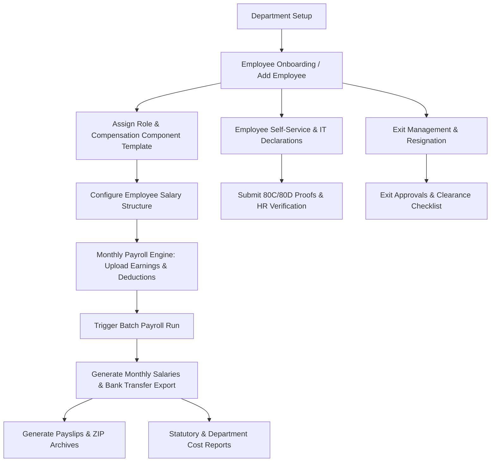
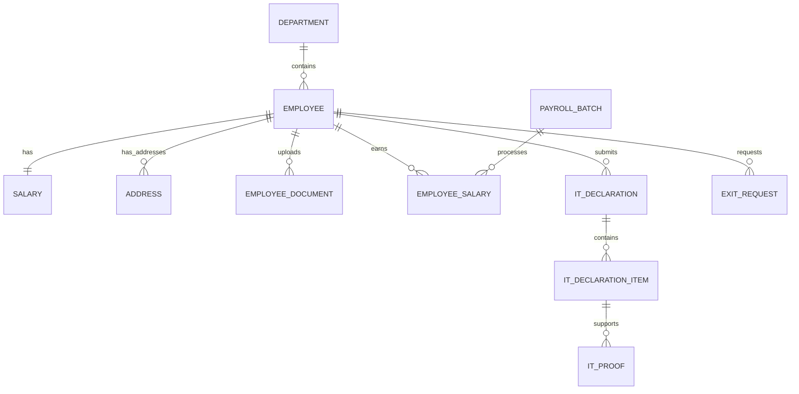
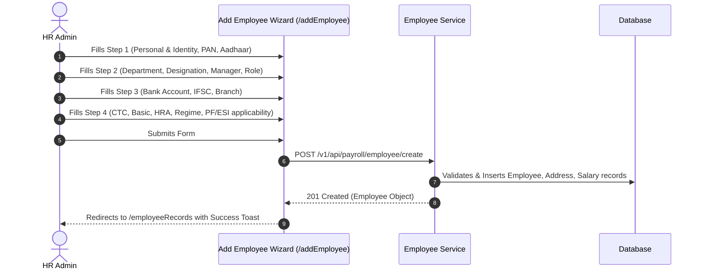
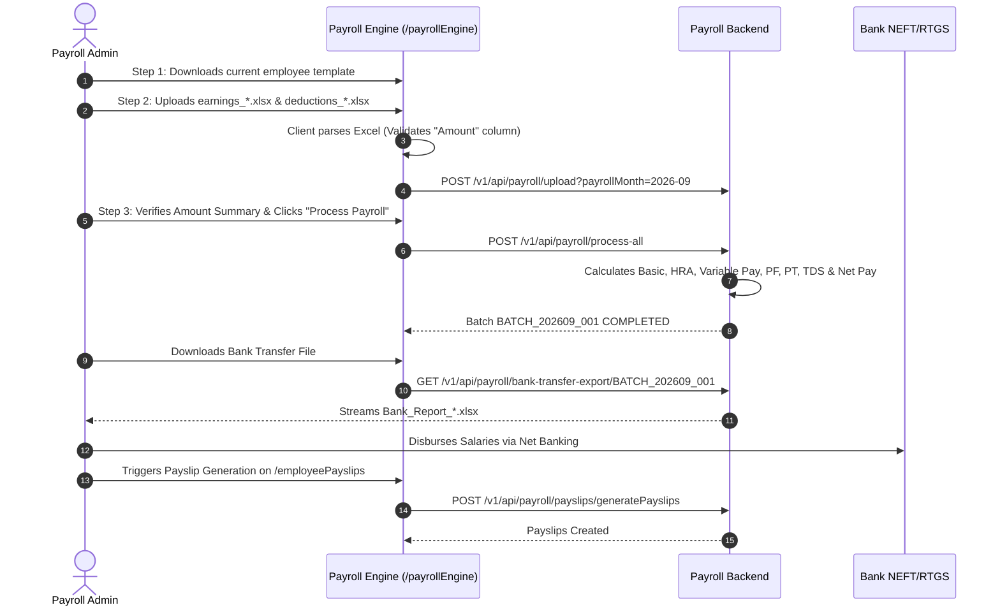

# HRMS MODULE
## Knowledge Transfer (KT) Document

**Version:** 1.0.0  
**Prepared Date:** October 15, 2026  
**Application:** MyTrade ERP Platform (`mytrading-ui`)  
**Module Owner:** HRMS & Payroll Engineering Team  

---

## TABLE OF CONTENTS
1. [HRMS Module Overview](#1-hrms-module-overview)
2. [HRMS Pages & Screens](#2-hrms-pages--screens)
3. [Module-Wise Documentation](#3-module-wise-documentation)
   - 3.1 Department Management
   - 3.2 Employee Compensation
   - 3.3 Employee Records & Onboarding
   - 3.4 Salary Records
   - 3.5 Payslips & Batch Generation
   - 3.6 Reports & Compliance (Payroll & Department)
   - 3.7 Payroll Engine (Excel Ingestion & Batch Runs)
   - 3.8 IT Declaration & Tax Proof Verification
   - 3.9 Salary Structure Management
   - 3.10 Employee Document Management
   - 3.11 Exit Management (Employee Resignation)
   - 3.12 Exit Approvals & Offboarding
   - 3.13 Additional Implemented Modules (Statutory Compliances, Benefits)
4. [API & Backend KT](#4-api--backend-kt)
5. [Database & Data Model](#5-database--data-model)
6. [Important Business Workflows](#6-important-business-workflows)
7. [Role & Permission Model](#7-role--permission-model)
8. [Frontend Implementation](#8-frontend-implementation)
9. [Backend Implementation & Architecture](#9-backend-implementation--architecture)
10. [Integrations & Dependencies](#10-integrations--dependencies)
11. [Configuration & Environment Variables](#11-configuration--environment-variables)
12. [Validations & Business Rules](#12-validations--business-rules)
13. [Error Handling & Common Issues](#13-error-handling--common-issues)
14. [Testing Guide & QA Checklist](#14-testing-guide--qa-checklist)
15. [Deployment & Running Locally](#15-deployment--running-locally)
16. [Troubleshooting Guide](#16-troubleshooting-guide)
17. [Known Gaps & Technical Debt](#17-known-gaps--technical-debt)
18. [Quick KT Summary: "If You Need to Change X, Go Here"](#18-quick-kt-summary-if-you-need-to-change-x-go-here)
19. [HRMS Module Map](#19-hrms-module-map)
- [Document Summary](#document-summary)
- [Known Limitations](#known-limitations)
- [Open Questions](#open-questions)
- [Recommended Next Steps](#recommended-next-steps)

---

## 1. HRMS MODULE OVERVIEW

### 1.1 What the HRMS Module Does
The Human Resource Management System (HRMS) & Payroll module is the core enterprise human capital and compensation backbone of MyTrade ERP. It orchestrates the entire employee lifecycle—from onboarding, profile maintenance, departmental hierarchy, salary template assignment, dynamic variable earnings/deductions ingestion, automated payroll calculation, statutory compliance generation (PF/ESI/PT), tax declarations, to structured resignation, clearance, and offboarding workflows.

### 1.2 Purpose of the Module
The purpose of the HRMS module is to:
- Centralize employee master data, personal identity records, banking details, and statutory numbers (PAN, Aadhaar, PF, UAN).
- Maintain organizational hierarchy through department management.
- Standardize salary structures and compensation packages based on employee roles.
- Automate monthly payroll processing batches with variable earnings and deductions uploaded via validated Excel sheets.
- Provide employee self-service capabilities for payslip downloads, tax regime selection (Old vs. New), Section 80C/80D investment declarations, proof uploads, and resignation requests.
- Ensure strict compliance with regional statutory mandates and generate banking disbursement NEFT/RTGS batch files.

### 1.3 Main Users & Roles
| Role | Responsibility | Scope in HRMS |
| :--- | :--- | :--- |
| **SUPER_ADMIN** | Organization Owner / System Admin | Full system access across all tenants, domains, approval configurations, and financial overrides. |
| **ADMIN / HR Admin** | HR Director / Operations Head | Onboarding employees, updating compensation, managing departments, approving IT declarations, and executing payroll runs. |
| **MANAGER / Approver** | Team Lead / Department Head | Reviewing employee leave, resignation requests, notice period waivers, and approving offboarding clearances. |
| **USER / EMPLOYEE** | Regular Organization Employee | Self-service view of salary breakdown, payslip PDF downloads, IT declaration submissions, proof uploading, and resignation filing. |

### 1.4 Major Business Areas & How They Connect
The HRMS module is structured into four primary operational areas:
1. **Employee Management:** Organization hierarchy (Departments), Employee Directory (Records), Multi-Step Onboarding Wizard, Document Repository, and Profile Views.
2. **Payroll & Compensation:** Role-based Compensation templates, Employee Salary Structures, Variable Data Excel Ingestion, Automated Batch Engine, Individual Salary Ledger, and Payslip Generation.
3. **Reports & Compliance:** Organization-wide Payroll Monthly Summaries, Department-wise Cost Breakdown, Statutory Compliances (PF ECR Challans, ESI, Professional Tax), and IT Declaration management.
4. **Exit Management:** Employee Resignation Portal, Clearance Checklists (IT, HR, Finance, Admin), Notice Period Tracking, and Admin/Manager Exit Approvals.

### 1.5 High-Level Architecture & Workflow


### 1.6 Project Navigation Structure
In the application sidebar (`src/layout/AppSidebar.tsx`), HRMS is organized into 4 collapsible sub-categories:
```
HRMS
 ├── Employee Management
 │    ├── Employee Records (/employeeRecords)
 │    ├── Department (/employeeDepartments)
 │    └── Documents (/employeeDocuments)
 ├── Payroll & Compensation
 │    ├── Payroll Engine (/payrollEngine)
 │    ├── Salary Structure (/salaryStructure)
 │    ├── Compensation (/employeeCompensation)
 │    ├── Salary (/employeeSalary)
 │    ├── Payslips (/employeePayslips)
 │    └── IT Declaration (/it-declaration)
 ├── Exit & Offboarding
 │    ├── Exit Management (/exit-management)
 │    └── Exit Approvals (/exitApprovals) [Restricted to SUPER_ADMIN, ADMIN, MANAGER]
 └── Reports
      ├── Payroll Summary (/payrollSummary)
      └── Department Summary (/departmentSummary)
```

---

## 2. HRMS PAGES / SCREENS

The following table comprehensively maps every HRMS page from both the business reference documentation and the actual frontend codebase:

| Page | Route | Purpose | Role | Main APIs | Related Modules | Status / Note |
| :--- | :--- | :--- | :--- | :--- | :--- | :--- |
| **Department** | `/employeeDepartments` | Create, edit, list, and delete organizational departments | `ADMIN`, `SUPER_ADMIN` | `GET /v1/api/payroll/department/listAll`<br>`POST /v1/api/payroll/department/create`<br>`PUT /v1/api/payroll/department/update`<br>`DELETE /v1/api/payroll/department/delete/{id}` | Employee Records, Onboarding | **[BOTH]**<br>*(Doc listed route as `/employee-department`)* |
| **Compensation** | `/employeeCompensation` | Define role-based salary component percentage distribution templates | `ADMIN`, `SUPER_ADMIN` | `GET /v1/api/payroll/employee/getPayroleComponents`<br>`POST /v1/api/payroll/employee/create/payroleComponents`<br>`PUT /v1/api/payroll/employee/update/payroleComponent`<br>`DELETE /v1/api/payroll/employee/delete/payroleComponent/{role}` | Salary Structure, Onboarding | **[BOTH]**<br>*(Doc listed route as `/payroll/employee-compensation` and per-employee CTC API)* |
| **Employee Records** | `/employeeRecords` | Master employee directory with filters, status flags, and Excel/PDF export | `ADMIN`, `SUPER_ADMIN`, `MANAGER` | `GET /v1/api/payroll/employee/all`<br>`GET /v1/api/payroll/department/listAll`<br>`GET /v1/api/payroll/employee/export`<br>`DELETE /v1/api/payroll/employee/delete/{id}` | Add Employee, Employee View | **[BOTH]**<br>*(Doc listed route as `/payroll/employee-records`)* |
| **Add Employee** | `/addEmployee` | 4-step comprehensive employee onboarding wizard | `ADMIN`, `SUPER_ADMIN` | `POST /v1/api/payroll/employee/create`<br>`PUT /v1/api/payroll/employee/update/{id}`<br>`GET /v1/api/payroll/employee/read/{id}`<br>`GET /v1/api/user/tenants`<br>`GET /v1/api/user/domains`<br>`GET /v1/api/user/roles/getAll` | Employee Records, Role Config | **[Implemented but not documented]** |
| **Employee View** | `/employee-view/:id` | Read-only detailed 360-degree employee profile with embedded payslips tab | `ALL` (Self / Admin) | `GET /v1/api/payroll/employee/read/{id}`<br>`GET /v1/api/payroll/payslips/employee/avilableMonths/{id}` | Employee Records, Payslips | **[Implemented but not documented]** |
| **Salary Records** | `/employeeSalary` | Displays processed and pending monthly employee salaries with deductions and regime | `ADMIN`, `SUPER_ADMIN` | `GET /v1/api/payroll/employee-salaries`<br>`GET /v1/api/payroll/employee/all` | Payroll Engine, Payslips | **[BOTH]**<br>*(Doc listed route as `/payroll/salary-records` and endpoint `/payroll-records`)* |
| **Payslips & Payroll Runs** | `/employeePayslips` *(alias `/employeePayroll`)* | Generate monthly payslips, trigger processing, rollback salary, download ZIPs and individual PDFs | `ADMIN`, `SUPER_ADMIN`, `EMPLOYEE` | `GET /v1/api/payroll/salary-summary?yearMonth={m}`<br>`POST /v1/api/payroll/process-all?month={m}`<br>`POST /v1/api/payroll/payslips/generatePayslips`<br>`GET /v1/api/payroll/payslips/download-zip`<br>`GET /v1/api/payroll/payslips/preview/{id}`<br>`GET /v1/api/payroll/payslips/download`<br>`POST /v1/api/payroll/rollback/{id}` | Salary, Payroll Engine | **[BOTH]**<br>*(Doc listed route as `/payroll/my-payslips`)* |
| **Payroll Engine** | `/payrollEngine` | Multi-step variable pay processing: download template, upload earnings/deductions Excel, run batch, export bank transfers | `ADMIN`, `SUPER_ADMIN` | `GET /v1/api/payroll/employee/export`<br>`GET /v1/api/payroll/excel/amount-summary`<br>`POST /v1/api/payroll/upload?payrollMonth={m}`<br>`POST /v1/api/payroll/process-all`<br>`GET /v1/api/payroll/getPayrollBatchInfo`<br>`GET /v1/api/payroll/bank-transfer-export/{batch}` | Payroll Summary, Payslips | **[BOTH]**<br>*(Doc listed route as `/payroll/processing-engine`)* |
| **IT Declaration** | `/it-declaration` | Tax regime selection (OLD vs NEW), Section 80C/80D/HRA investment declarations, proof attachments, lock/unlock, and HR verification | `EMPLOYEE`, `ADMIN`, `HR` | `GET /v1/api/payroll/it-declaration/fetchAvailableSections`<br>`GET /v1/api/payroll/it-declaration/fetchDeclarationByEmpId/{id}`<br>`POST /v1/api/payroll/it-declaration/submit`<br>`POST /v1/api/payroll/it-declaration/item/{itemId}/link-proof`<br>`PUT /v1/api/payroll/it-declaration/proof/{proofId}/verify`<br>`PUT /v1/api/payroll/it-declaration/item/{itemId}/approve`<br>`PUT /v1/api/payroll/it-declaration/item/{itemId}/reject`<br>`POST /v1/api/payroll/it-declaration/{id}/unlock`<br>`POST /v1/api/payroll/it-declaration/{id}/lock` | Employee Records, Salary Structure | **[BOTH]**<br>*(Doc listed route as `/payroll/it-declarations`)* |
| **Salary Structure** | `/salaryStructure` | Configures per-employee salary baseline (Basic, HRA, Allowances, Deductions, CTC, Net Salary) | `ADMIN`, `SUPER_ADMIN` | `GET /v1/api/payroll/salary-structures`<br>`POST /v1/api/payroll/salary-structures`<br>`PUT /v1/api/payroll/salary-structures/{id}`<br>`DELETE /v1/api/payroll/salary-structures/{id}` | Compensation, Employee Records | **[BOTH]**<br>*(Doc listed route as `/payroll/salary-structures`)* |
| **Documents** | `/employeeDocuments` *(alias `/document-management`, `/employees/:employeeId/documents`)* | Upload, preview, download, and delete employee compliance credentials (Aadhaar, PAN, Passport, Certificates) | `ALL` (Scoped) | `GET /v1/api/payroll/empdocuments/employee/{id}`<br>`POST /v1/api/payroll/empdocuments/upload/{id}`<br>`DELETE /v1/api/payroll/empdocuments/documents/{id}`<br>`GET /v1/api/payroll/empdocuments/documents/{docId}/download` | Employee Records, Onboarding | **[BOTH]**<br>*(Doc listed route as `/payroll/employee-documents`)* |
| **Exit Management** | `/exit-management` | Employee resignation submission portal, notice period calculator, proposed LWD selector, and clearance progress tracker | `EMPLOYEE`, `USER` | `GET /v1/api/payroll/employee/all`<br>`POST /v1/api/payroll/exit/request/submitExitRequest`<br>`GET /v1/api/payroll/exit/getExitRequest/{employeeId}` | Exit Approvals | **[BOTH]**<br>*(Doc listed route as `/payroll/exit-request`)* |
| **Exit Approvals** | `/exitApprovals` | Manager & HR review console for approving/rejecting resignations and handling resignation withdrawal reversals | `SUPER_ADMIN`, `ADMIN`, `MANAGER` | `GET /v1/api/payroll/exit/getAllExitRequests`<br>`PUT /v1/api/payroll/exit/{id}/approve`<br>`PUT /v1/api/payroll/exit/reject-resignation/{employeeId}`<br>`PUT /v1/api/payroll/exit/revert-resignation/{employeeId}`<br>`PUT /v1/api/payroll/exit/updateExitDetails` | Exit Management | **[BOTH]**<br>*(Doc listed route as `/payroll/exit-approvals`)* |
| **Payroll Summary Report** | `/payrollSummary` | Monthly executive dashboard with Gross/Net/Employee KPI cards, Recharts visualizations, and detailed Excel export | `ADMIN`, `SUPER_ADMIN`, `HR` | `GET /v1/api/payroll/reports/getPayrollSummary?payrollMonth={m}`<br>`GET /v1/api/payroll/reports/getPayrollDetailReportByMonth?payrollMonth={m}` | Reports, Department Summary | **[BOTH]**<br>*(Doc listed route as `/payroll/summary-report`)* |
| **Department Summary Report** | `/departmentSummary` | Department-wise headcount and monthly salary payout distribution with bar and pie charts | `ADMIN`, `SUPER_ADMIN`, `HR` | `GET /v1/api/payroll/reports/department-summary?payrollMonth={m}` | Reports, Department | **[Implemented but not documented]** |
| **Statutory Compliances** | `/statutoryCompliances` | Configures PF/ESI/Gratuity/PT applicability, employee statutory IDs, monthly compliance summary, and EPFO ECR Challan download | `ADMIN`, `HR` | `GET /v1/api/payroll/statutory/components`<br>`GET /v1/api/payroll/statutory/employee/{id}`<br>`GET /v1/api/payroll/statutory/monthly-summary`<br>`GET /v1/api/payroll/statutory/form/pf-ecr`<br>`POST /v1/api/payroll/statutory/components/create`<br>`PUT /v1/api/payroll/statutory/components/update` | Reports, Payroll Engine | **[Implemented but not documented in primary nav]** *(Referenced under Reports in doc)* |

---

## 3. MODULE-WISE DOCUMENTATION

### 3.1 Department Management
1. **Purpose:** Maintain organizational business units (e.g., Engineering, Sales, Human Resources, Management).
2. **User Flow:** Admin navigates to `/employeeDepartments` → Views department table → Clicks "Add Department" → Enters Department Name → Submits. Edit/Delete actions available on row hover/click.
3. **UI / Pages:** `src/pages/Payroll/EmployeeDepartments.tsx`.
4. **APIs:**
   - `GET /v1/api/payroll/department/listAll`
   - `POST /v1/api/payroll/department/create`
   - `PUT /v1/api/payroll/department/update`
   - `DELETE /v1/api/payroll/department/delete/{id}`
5. **Request Parameters:**
   - Create: `{ "name": "Quality Assurance" }`
   - Update: `{ "id": 5, "name": "Quality Assurance & Testing" }`
   - Delete: Path variable `id`
6. **Response Structure:** Department object or array: `[{ id: 1, name: "Engineering", createdDate: "...", updatedDate: "..." }]`.
7. **Database Entities:** `departments` table (`id`, `name`, `created_date`, `updated_date`).
8. **Business Rules:** Department names must be non-empty and unique. Deletion requires confirmation dialog.
9. **Validations:** Blank or whitespace-only department names trigger error toast.
10. **Error Handling:** Axios catch block with fallback to `err.response?.data?.message`.
11. **Permissions / Roles:** Restricted to `ADMIN` and `SUPER_ADMIN`.
12. **Dependencies:** Reusable table, ConfirmDialog, ToasterService.
13. **Related Modules:** Employee Records, Add Employee, Department Summary Report.

### 3.2 Employee Compensation
1. **Purpose:** Configure standardized compensation component percentages (e.g., Basic 50%, HRA 20%, Special Allowance 30%) mapped to job roles.
2. **User Flow:** Admin navigates to `/employeeCompensation` → Views existing role templates → Clicks "+ Add Compensation" → Enters Role Name → Adds dynamic component rows (Name & Percentage) → Checks total percentage (must equal 100%) → Saves.
3. **UI / Pages:** `src/pages/Payroll/EmployeeCompensationPage.tsx`.
4. **APIs:**
   - `GET /v1/api/payroll/employee/getPayroleComponents`
   - `POST /v1/api/payroll/employee/create/payroleComponents`
   - `PUT /v1/api/payroll/employee/update/payroleComponent`
   - `DELETE /v1/api/payroll/employee/delete/payroleComponent/{role}`
5. **Request Parameters:**
   ```json
   {
     "components": [
       {
         "employeeRole": "Senior Software Engineer",
         "componentDetails": {
           "Basic": 50,
           "HRA": 20,
           "Special Allowance": 30
         }
       }
     ]
   }
   ```
6. **Response Structure:** Object containing array of role components.
7. **Database Entities:** `compensation_components` / `payroll_components` table.
8. **Business Rules:**
   - [CODE] Components are mapped to `employeeRole`.
   - [CODE] Component percentages are restricted between 1% and 100%.
   - [DOCUMENTATION DIFFERENCE] Documented `GET /v1/api/payroll/compensation/employee/{employeeId}` and `POST /v1/api/payroll/compensation/save` for individual employee CTC assignment is **"Documented but implementation not found"** at this specific endpoint; in code, individual employee CTC is assigned directly in the employee master via `addEmployeesPage.tsx` and `SalaryStructurePage.tsx`.
9. **Validations:** Role name is mandatory; component names cannot be empty; percentages must be numeric (1-100).
10. **Error Handling:** Standardized ToasterService notifications.
11. **Permissions / Roles:** `SUPER_ADMIN`, `ADMIN`.
12. **Dependencies:** `ToasterService`, `ConfirmDialog`, `ReusableTable`.
13. **Related Modules:** Salary Structure, Add Employee, Payroll Engine.

### 3.3 Employee Records & Onboarding
1. **Purpose:** Master directory of all employees with comprehensive onboarding wizard (personal, organizational, banking, salary, statutory).
2. **User Flow:**
   - Listing: Navigates to `/employeeRecords` → Filters by department or search query → Exports to Excel or PDF.
   - Onboarding: Clicks "Add Employee" → Redirects to `/addEmployee` → Completes Step 1 (Personal & Address), Step 2 (Employment & Hierarchy), Step 3 (Banking), Step 4 (Salary & Statutory) → Submits.
   - Viewing: Clicks employee row or View button → Opens `/employee-view/:id`.
3. **UI / Pages:**
   - `src/pages/Payroll/EmployeeRecordsPage.tsx`
   - `src/pages/Payroll/addEmployeesPage.tsx`
   - `src/pages/Payroll/EmployeeViewPage.tsx`
4. **APIs:**
   - `GET /v1/api/payroll/employee/all`
   - `GET /v1/api/payroll/employee/read/{id}`
   - `POST /v1/api/payroll/employee/create`
   - `PUT /v1/api/payroll/employee/update/{id}`
   - `DELETE /v1/api/payroll/employee/delete/{id}`
   - `GET /v1/api/payroll/employee/export` (Binary XLSX)
   - `GET /v1/api/user/tenants`, `GET /v1/api/user/domains`, `GET /v1/api/user/roles/getAll`
5. **Request Parameters:** Full `EmployeeCreateInput` / `EmployeeUpdateInput` payload (see Section 5 for fields).
6. **Response Structure:** List of `Employee` objects or single `Employee` object.
7. **Database Entities:** `employees`, `addresses`, `salaries`, `departments`, `user_roles`.
8. **Business Rules:**
   - [CODE] Official email must be valid and formatted.
   - [CODE] Bank details (IFSC, Account number) are validated.
   - [CODE] Country-specific statutory identifiers (PAN: 10 chars uppercase alphanumeric `[A-Z]{5}[0-9]{4}[A-Z]{1}`, Aadhaar: 12 digits, UAN: 12 digits) enforced.
9. **Validations:** Step-by-step required field validations before proceeding to the next onboarding step.
10. **Error Handling:** Parsing blob error responses during export; inline field validation highlighting.
11. **Permissions / Roles:** Creation/deletion restricted to `ADMIN` and `SUPER_ADMIN`.
12. **Dependencies:** `react-phone-input-2`, `country-state-city`, `react-datepicker`, `react-select`.
13. **Related Modules:** Documents, Salary Structure, Compensation, IT Declaration, Exit Management.

### 3.4 Salary Records
1. **Purpose:** View calculated and processed monthly salary items for all employees across pay periods.
2. **User Flow:** User navigates to `/employeeSalary` → Filters by month, tax regime (OLD vs NEW), or employee name/code → Inspects basic, HRA, allowances, gross, total deductions, and net salary.
3. **UI / Pages:** `src/pages/Payroll/EmployeeSalaryPage.tsx`.
4. **APIs:**
   - `GET /v1/api/payroll/employee-salaries`
   - `GET /v1/api/payroll/employee/all`
5. **Request Parameters:** Filter query params: `yearMonth`, `employeeId`.
6. **Response Structure:**
   ```json
   [
     {
       "id": 101,
       "employeeId": 71,
       "month": "2026-09",
       "basic": 50000,
       "hra": 20000,
       "bonus": 5000,
       "grossSalary": 100000,
       "tds": 4500,
       "professionalTax": 200,
       "pfEmployee": 1800,
       "netSalary": 93500,
       "processed": true,
       "regime": "OLD"
     }
   ]
   ```
7. **Database Entities:** `employee_salaries` table.
8. **Business Rules:**
   - [BOTH] `Gross Salary = Basic + HRA + Sum(Earnings/Bonus)`.
   - [BOTH] `Net Salary = Gross Salary - Total Deductions (PF + PT + TDS + Other)`.
   - [DOCUMENTATION DIFFERENCE] Documented `PUT /v1/api/payroll/payroll-records/{id}` for manual adjustments is **"Documented but implementation not found"** on `/employeeSalary`; adjustments are handled via variable Excel ingestion in the Payroll Engine.
9. **Validations:** Read-only historical ledger view with client-side regex search.
10. **Error Handling:** Graceful fallback to empty state with retry mechanism.
11. **Permissions / Roles:** `ADMIN`, `SUPER_ADMIN`.
12. **Dependencies:** ReusableTable, Statscard.
13. **Related Modules:** Payroll Engine, Payslips, Payroll Summary Report.

### 3.5 Payslips & Batch Generation
1. **Purpose:** Centralized payroll execution portal for processing monthly runs, triggering payslip generation, previewing detailed breakdowns, and downloading individual or range-based ZIP archives.
2. **User Flow:**
   - Admin selects Pay Month (e.g., `2026-09`) → Clicks "Process Payroll" → Confirms batch execution.
   - Clicks "Generate Payslips" → System compiles PDF slips for all active employees.
   - Clicks "Download ZIP" → Selects Employee, From Month, and To Month → Downloads bundled ZIP.
   - Individual preview: Clicks eye icon on row → Opens `PayslipPreviewModal` → Downloads single PDF.
3. **UI / Pages:**
   - `src/pages/Payroll/PayrollPage.tsx`
   - `src/pages/Payroll/MyPayslipsTab.tsx`
   - `src/components/Payroll/PayslipPreviewModal.tsx`
4. **APIs:**
   - `GET /v1/api/payroll/salary-summary?yearMonth={filterMonth}`
   - `POST /v1/api/payroll/process-all?month={processMonth}`
   - `POST /v1/api/payroll/payslips/generatePayslips` (Body: `{ "yearMonth": "2026-09" }`)
   - `GET /v1/api/payroll/payslips/preview/{employeeId}?month={month}`
   - `GET /v1/api/payroll/payslips/download?employeeId={id}&month={month}` (Binary application/pdf)
   - `GET /v1/api/payroll/payslips/download-zip?employeeId={id}&fromMonth={m1}&toMonth={m2}` (Binary application/zip)
   - `POST /v1/api/payroll/rollback/{id}`
5. **Request Parameters:** Mentioned above with query params and JSON bodies.
6. **Response Structure:** Preview returns JSON object with employee metadata, itemized earnings list, itemized deductions list, gross, and net pay.
7. **Database Entities:** `employee_salaries`, `payslip_records`, `payroll_batches`.
8. **Business Rules:**
   - [CODE] From Month cannot be after To Month when generating date-range ZIP files.
   - [CODE] Rollback action reverses a processed salary back to draft status for correction.
9. **Validations:** Required date selections, modal confirmation before irreversible batch actions.
10. **Error Handling:** Blob error responses decoded; toast alerts on failure.
11. **Permissions / Roles:** Processing and bulk generation restricted to `ADMIN` and `SUPER_ADMIN`. Individual preview/download available to `EMPLOYEE` for their own ID.
12. **Dependencies:** `jspdf`, `jspdf-autotable`, `react-to-print`, `framer-motion`.
13. **Related Modules:** Payroll Engine, Salary Records, Employee View.

### 3.6 Reports & Compliance (Payroll & Department)
1. **Purpose:** Provide operational insights into company-wide payroll expenses, department cost centers, and statutory liabilities.
2. **User Flow:**
   - Payroll Summary: Navigates to `/payrollSummary` → Picks Month → Observes Total Gross, Total Net, Employee Count → Reviews Recharts bar and pie charts → Exports detailed Excel report.
   - Department Summary: Navigates to `/departmentSummary` → Picks Month → Views department headcount, total gross, and average cost per employee.
3. **UI / Pages:**
   - `src/pages/Payroll/PayrollSummaryPage.tsx`
   - `src/pages/Payroll/DepartmentSummaryPage.tsx`
   - `src/pages/Payroll/StatutoryCompliancesPage.tsx`
4. **APIs:**
   - `GET /v1/api/payroll/reports/getPayrollSummary?payrollMonth={month}`
   - `GET /v1/api/payroll/reports/getPayrollDetailReportByMonth?payrollMonth={month}`
   - `GET /v1/api/payroll/reports/department-summary?payrollMonth={month}`
   - `GET /v1/api/payroll/statutory/monthly-summary?month={month}`
   - `GET /v1/api/payroll/statutory/form/pf-ecr?month={month}`
5. **Request Parameters:** Query param `payrollMonth` (YYYY-MM).
6. **Response Structure:**
   - Payroll Summary: `{ "totalGrossSalary": 15000000, "totalNetSalary": 13800000, "totalEmployees": 150 }`.
   - Department Summary: `[{ "departmentName": "Engineering", "employeeCount": 45, "totalGross": 6500000 }]`.
   - PF ECR: Raw formatted ASCII/text file formatted according to EPFO portal specs (#~# delimiter).
7. **Database Entities:** Aggregation queries on `employee_salaries`, `departments`, `employees`.
8. **Business Rules:**
   - [CODE] Department Summary is **"Implemented but not documented"** in original business document.
   - [BOTH] PF ECR export conforms to EPFO electronic challan return text format.
9. **Validations:** Disables charts and displays placeholder when no payroll has been executed for the selected month.
10. **Error Handling:** Handled via descriptive status banners and toasts.
11. **Permissions / Roles:** `ADMIN`, `SUPER_ADMIN`, `HR`.
12. **Dependencies:** `recharts`, `xlsx`, `file-saver`.
13. **Related Modules:** Payroll Engine, Department, Statutory Compliances.

### 3.7 Payroll Engine (Excel Ingestion & Batch Runs)
1. **Purpose:** Primary end-to-end processing engine for uploading monthly variable inputs, validating structure, running automated calculation batches, and downloading bank payout files.
2. **User Flow:**
   - Step 1: Navigates to `/payrollEngine` → Clicks "Download Employee Template" → Receives current employee base (`employees_<timestamp>.xlsx`).
   - Step 2: Prepares variable Excel sheets (e.g., `earnings_bonus_sep.xlsx`, `deductions_lop_sep.xlsx`) → Enters Salary Month → Uploads files.
   - Step 3: Reviews Amount Summary (Total Earnings vs. Total Deductions) → Clicks "Trigger Payroll Process".
   - Step 4: System redirects to Batch History tab → Displays batch reference (`BATCH_YYYYMM_XXX`), status, and count → Downloads bank transfer NEFT/RTGS Excel.
3. **UI / Pages:** `src/pages/Payroll/PayrollProcessingEnginePage.tsx`.
4. **APIs:**
   - `GET /v1/api/payroll/employee/export` (Download template)
   - `GET /v1/api/payroll/excel/amount-summary?payrollMonth={month}`
   - `POST /v1/api/payroll/upload?payrollMonth={month}` (FormData with `file`)
   - `POST /v1/api/payroll/process-all` (Body: `{ "month": "2026-09" }`)
   - `GET /v1/api/payroll/getPayrollBatchInfo`
   - `GET /v1/api/payroll/bank-transfer-export/{batchReference}`
   - `GET /v1/api/payroll/payslips/download?employeeId={id}&month={month}`
5. **Request Parameters:** Described in detail in Section 4.
6. **Response Structure:** Batch info array, summary cards, and file download streams.
7. **Database Entities:** `payroll_batches`, `batch_files`, `employee_salaries`.
8. **Business Rules:**
   - [CODE] File names MUST strictly start with `deductions_` or `earnings_` (case-insensitive).
   - [CODE] Uploaded Excel files MUST contain a column named `Amount` (case-insensitive); validated locally in the browser before POST request!
   - [CODE] Future date payroll processing is blocked: if `salaryMonth > currentMonth`, error toast is raised.
9. **Validations:** Local in-memory sheet parsing via `xlsx` library before upload.
10. **Error Handling:** Displays file parsing exceptions and backend execution errors clearly in UI banners.
11. **Permissions / Roles:** Restricted to `ADMIN` and `SUPER_ADMIN`.
12. **Dependencies:** `xlsx`, `ReusableTable`, `ToasterService`.
13. **Related Modules:** Salary Records, Payslips, Payroll Summary.

### 3.8 IT Declaration & Tax Proof Verification
1. **Purpose:** Complete income tax declaration portal supporting Old vs. New tax regimes, Section 80C, 80D, 80E, 80G, 24B, HRA, and electric vehicle loan exemptions, complete with proof upload and HR verification.
2. **User Flow:**
   - Employee: Selects regime (Old vs. New) → Selects section (e.g., 80C) → Adds item (e.g., LIC, PPF, ELSS) with declared amount → Uploads supporting proof document → Clicks "Submit Declaration".
   - HR Admin: Reviews declarations → Verifies proofs → Approves or rejects individual line items with approved amount and remarks → Locks declaration for the financial year.
3. **UI / Pages:** `src/pages/Payroll/ItDeclarationPage.tsx`.
4. **APIs:**
   - `GET /v1/api/payroll/it-declaration/fetchAvailableSections`
   - `GET /v1/api/payroll/it-declaration/fetchDeclarationByEmpId/{employeeId}`
   - `POST /v1/api/payroll/it-declaration/submit`
   - `POST /v1/api/payroll/it-declaration/item/{itemId}/link-proof`
   - `PUT /v1/api/payroll/it-declaration/proof/{proofId}/verify`
   - `PUT /v1/api/payroll/it-declaration/item/{itemId}/approve`
   - `PUT /v1/api/payroll/it-declaration/item/{itemId}/reject`
   - `POST /v1/api/payroll/it-declaration/{id}/unlock`
   - `POST /v1/api/payroll/it-declaration/{id}/lock`
   - `GET /v1/api/payroll/it-declaration/it-proofs/download/{employeeId}`
5. **Request Parameters:** Full details provided in Section 4.
6. **Response Structure:** Declaration object containing status, items list, proof arrays, and audit dates.
7. **Database Entities:** `it_declarations`, `it_declaration_items`, `it_proofs`, `tax_sections`.
8. **Business Rules:**
   - [CODE] Sections fetched dynamically from backend `/fetchAvailableSections` and merged with client-side definitions (80C, 80D, 80E, 80G, 24B, HRA, 80CCD_1B, 80EE, 80EEA, 80EEB).
   - [CODE] When status is `LOCKED`, `SUBMITTED`, or `APPROVED`, modifications are blocked for employees unless HR unlocks the record.
   - [CODE] Section utilization bar highlights when declared amount exceeds statutory maximum limit (e.g., ₹1,50,000 for 80C).
9. **Validations:** Amounts must be positive numbers; file types restricted to valid image/PDF extensions; proof file size limits.
10. **Error Handling:** Modal confirmations for destructive or locking actions; toast notifications on status transitions.
11. **Permissions / Roles:** Employee can declare and upload proofs; HR can verify, approve, reject, lock, and unlock.
12. **Dependencies:** `lucide-react`, `framer-motion`, `ToasterService`.
13. **Related Modules:** Employee Records, Salary Structure, Payslips.

### 3.9 Salary Structure Management
1. **Purpose:** Define and maintain per-employee monthly base salary structures and baseline compensation figures.
2. **User Flow:** Admin navigates to `/salaryStructure` → Views table of employee salary baselines → Clicks "Add Salary Structure" → Enters Employee ID, Basic, HRA, Allowances, Deductions, and Effective Date → Submits.
3. **UI / Pages:** `src/pages/Payroll/SalaryStructurePage.tsx`.
4. **APIs:**
   - `GET /v1/api/payroll/salary-structures`
   - `POST /v1/api/payroll/salary-structures`
   - `PUT /v1/api/payroll/salary-structures/{id}`
   - `DELETE /v1/api/payroll/salary-structures/{id}`
5. **Request Parameters:**
   ```json
   {
     "employeeId": "71",
     "basic": 50000,
     "hra": 20000,
     "allowances": 30000,
     "deductions": 6500,
     "effectiveFrom": "2026-04-01",
     "netSalary": 93500,
     "ctc": 1200000,
     "totalDeductions": 6500
   }
   ```
6. **Response Structure:** List or single `SalaryStructure` object.
7. **Database Entities:** `salary_structures` table (`id`, `employee_id`, `basic`, `hra`, `allowances`, `total_deductions`, `net_salary`, `ctc`, `effective_from`).
8. **Business Rules:**
   - [CODE] `netSalary = basic + hra + allowances - deductions`.
   - [CODE] `ctc = (basic + hra + allowances) * 12`.
   - [DOCUMENTATION DIFFERENCE] The reference document described a template-level structure (`structureName`, `basicPercentage`, `hraPercentage`, `pfApplicable`). In the actual code, `SalaryStructurePage.tsx` manages employee-specific numerical configurations, while template percentages are managed under `EmployeeCompensationPage.tsx`.
9. **Validations:** Numeric values only; prevents negative numbers; requires valid employee reference.
10. **Error Handling:** ConfirmDialog on deletion; ToasterService alerts.
11. **Permissions / Roles:** Restricted to `ADMIN` and `SUPER_ADMIN`.
12. **Dependencies:** `jspdf`, `jspdf-autotable`, `xlsx`, `ReusableTable`.
13. **Related Modules:** Compensation, Employee Records, Payroll Engine.

### 3.10 Employee Document Management
1. **Purpose:** Central repository for employee identity and compliance documents (PAN Card, Aadhaar, Passport, Educational Certificates, Relieving Letters).
2. **User Flow:** Admin or Employee opens `/employeeDocuments` (or `/employees/:employeeId/documents`) → Selects document type → Chooses file → Uploads → Previews uploaded document inline in modal or downloads.
3. **UI / Pages:**
   - `src/pages/Payroll/EmployeeDocumentsPage.tsx`
   - `src/pages/Payroll/DocumentManagementPage.tsx`
4. **APIs:**
   - `GET /v1/api/payroll/empdocuments/employee/{employeeId}`
   - `POST /v1/api/payroll/empdocuments/upload/{employeeId}` (FormData with `file` and `documentType`)
   - `GET /v1/api/payroll/empdocuments/documents/{docId}/download` (Blob stream)
   - `DELETE /v1/api/payroll/empdocuments/documents/{id}`
5. **Request Parameters:**
   - Upload: `FormData` with fields `file` (binary) and `documentType` (string, e.g., `PAN_CARD`, `AADHAAR`, `PASSPORT`).
   - Download/Delete: Document ID path parameter.
6. **Response Structure:** Array of document metadata: `[{ id: 201, documentType: "PAN_CARD", fileName: "pan.pdf", fileType: "application/pdf", verified: true, uploadedAt: "..." }]`.
7. **Database Entities:** `employee_documents` table (`id`, `employee_id`, `document_type`, `file_name`, `file_type`, `file_size`, `verified`, `uploaded_at`).
8. **Business Rules:**
   - [CODE] Document types supported: `PAN_CARD`, `AADHAAR_CARD`, `PASSPORT`, `DRIVING_LICENSE`, `VOTER_ID`, `EDUCATION_CERTIFICATE`, `EXPERIENCE_LETTER`, `PAYSLIP_PREVIOUS_EMPLOYER`, `OTHER`.
   - [CODE] Deletion requires confirmation and triggers immediate list refresh.
9. **Validations:** File selection and document type are required before submission.
10. **Error Handling:** Preview blob handling with object URL revocation to prevent memory leaks.
11. **Permissions / Roles:** Employees can view and upload their own documents; Admins can manage all documents.
12. **Dependencies:** `jspdf`, `jspdf-autotable`, `PaginatedPopup`, `ToasterService`.
13. **Related Modules:** Employee Records, Add Employee, Employee View.

### 3.11 Exit Management (Employee Resignation)
1. **Purpose:** Employee self-service resignation submission and offboarding tracking.
2. **User Flow:** Employee navigates to `/exit-management` → System resolves employee identity from authentication session → Displays resignation status or submission form → Employee selects resignation reason (e.g., Higher Studies, Relocation) → Sets notice period (default 90 days) → Proposed LWD is automatically calculated → Adds comments/attachments → Submits.
3. **UI / Pages:** `src/pages/Payroll/ExitManagementPage.tsx`.
4. **APIs:**
   - `GET /v1/api/payroll/employee/all` (Resolves current user's employee record)
   - `GET /v1/api/payroll/exit/getExitRequest/{employeeId}`
   - `POST /v1/api/payroll/exit/request/submitExitRequest`
5. **Request Parameters:**
   ```json
   {
     "employeeId": 71,
     "resignationDate": "2026-10-15",
     "noticePeriod": 90,
     "proposedLastWorkingDay": "2027-01-13",
     "reason": "Better Career Opportunity",
     "comment": "Pursuing higher career growth"
   }
   ```
6. **Response Structure:** `ExitRequest` object with `status: "SUBMITTED"`.
7. **Database Entities:** `exit_requests` table.
8. **Business Rules:**
   - [CODE] Default notice period is 90 days.
   - [CODE] Last Working Day is computed dynamically: `Resignation Date + Notice Period Days`.
   - [CODE] Displays offboarding task progress across categories: IT (Asset Return, ID Deactivation), HR (Knowledge Transfer), Finance (Expense Clearance).
   - [DOCUMENTATION DIFFERENCE] Documented endpoint `POST /v1/api/payroll/exit/resignation` is **"Documented but implementation not found"**; actual endpoint is `POST /v1/api/payroll/exit/request/submitExitRequest`.
9. **Validations:** Reason for leaving and proposed LWD are mandatory.
10. **Error Handling:** Clear toast error if submission fails or server rejects.
11. **Permissions / Roles:** Any logged-in employee (`USER` / `EMPLOYEE`).
12. **Dependencies:** `ExitManagementService`, `react-datepicker`, `lucide-react`.
13. **Related Modules:** Exit Approvals, Employee Records.

### 3.12 Exit Approvals & Offboarding
1. **Purpose:** Administrative console for HR and Managers to review, approve, reject, or revert employee resignations.
2. **User Flow:** Admin/Manager navigates to `/exitApprovals` → Views pending resignation requests table → Reviews employee details, resignation date, LWD, and reason → Clicks "Approve" to accept resignation, "Reject" to decline with comments, or handles resignation withdrawal requests.
3. **UI / Pages:** `src/pages/Payroll/ExitApprovalsPage.tsx`.
4. **APIs:**
   - `GET /v1/api/payroll/exit/getAllExitRequests`
   - `PUT /v1/api/payroll/exit/{id}/approve`
   - `PUT /v1/api/payroll/exit/reject-resignation/{employeeId}?reason={reason}`
   - `PUT /v1/api/payroll/exit/revert-resignation/{employeeId}?reason={reason}`
   - `PUT /v1/api/payroll/exit/updateExitDetails`
5. **Request Parameters:** Query parameters for reasons, path variable for exit ID, or JSON body for details update.
6. **Response Structure:** Updated `ExitRequest` record with status `APPROVED`, `REJECTED`, or `REVERTED`.
7. **Database Entities:** `exit_requests` table.
8. **Business Rules:**
   - [CODE] Non-admin users visiting `/exitApprovals` are automatically redirected/rendered the self-service `ExitManagementPage`.
   - [CODE] Withdrawal Approval: If an employee requested withdrawal (`WITHDRAW_REQUESTED`), admin can revert resignation via `revertResignation` API.
   - [DOCUMENTATION DIFFERENCE] Documented `PUT /v1/api/payroll/exit/{id}/approve` with full FnF calculation payload (`gratuityAmount`, `encashableLeaveDays`, `finalSettlementAmount`) is **"Documented but implementation not found"** in current frontend code; frontend currently sends a parameterless approval call to `PUT /v1/api/payroll/exit/{id}/approve`.
9. **Validations:** Rejection requires non-empty reason string.
10. **Error Handling:** Catches rejection/approval network errors and displays notification.
11. **Permissions / Roles:** Restricted to `SUPER_ADMIN`, `ADMIN`, `MANAGER`.
12. **Dependencies:** `ExitManagementService`, `ReusableTable`.
13. **Related Modules:** Exit Management, Employee Records.

### 3.13 Additional Implemented Modules
- **Statutory Compliances (`/statutoryCompliances`):** Fully implemented configuration for Provident Fund, ESI, Gratuity, Professional Tax, and government EPFO ECR Challan file generation.
- **Benefits & Allowances (`/benefits`):** Additional allowance configuration component calling `/v1/api/payroll/allowances`.
- **Payroll Runs History (`/payrollRuns`):** Detailed historical execution run logs.

---

## 4. API / BACKEND KT

This section documents all actual HRMS REST endpoints implemented in the application, including their exact HTTP methods, controllers, payloads, and business logic.

### 4.1 Department APIs
#### API: `GET /v1/api/payroll/department/listAll`
- **Purpose:** Retrieve all active organizational departments.
- **Authentication:** Bearer JWT token + `X-Tenant-ID` header.
- **Request Body:** None.
- **Response:** Array of `Department` objects.
- **Status Codes:** `200 OK`, `401 Unauthorized`.

#### API: `POST /v1/api/payroll/department/create`
- **Purpose:** Create a new department.
- **Request Body:**
  ```json
  { "name": "Quality Assurance" }
  ```
- **Response:**
  ```json
  { "id": 5, "name": "Quality Assurance", "message": "Department created successfully" }
  ```
- **Status Codes:** `201 Created`, `400 Bad Request`.

#### API: `PUT /v1/api/payroll/department/update`
- **Purpose:** Update existing department name.
- **Request Body:**
  ```json
  { "id": 5, "name": "QA & Automation" }
  ```
- **Status Codes:** `200 OK`, `404 Not Found`.

#### API: `DELETE /v1/api/payroll/department/delete/{id}`
- **Purpose:** Delete a department by ID.
- **Path Parameter:** `id` (Long).
- **Status Codes:** `200 OK`, `409 Conflict` (if employees are attached).

---

### 4.2 Employee Master & Onboarding APIs
#### API: `GET /v1/api/payroll/employee/all`
- **Purpose:** Fetch complete list of active employee records.
- **Response:** Array of `Employee` objects with nested salary, department, and address objects.

#### API: `GET /v1/api/payroll/employee/read/{id}`
- **Purpose:** Fetch single detailed employee record by ID.
- **Path Parameter:** `id` (Long).

#### API: `POST /v1/api/payroll/employee/create`
- **Purpose:** Onboard a new employee with complete profile, banking, statutory, and salary data.
- **Request Body:**
  ```json
  {
    "firstName": "Roy",
    "lastName": "Hamlin",
    "personalEmail": "roy.personal@example.com",
    "officialEmail": "roy.hamlin@mytrade.com",
    "maritalStatus": "MARRIED",
    "gender": "MALE",
    "phone": "+919876543210",
    "fatherName": "John Hamlin",
    "dateOfBirth": "1990-05-15",
    "employmentType": "FULL_TIME",
    "designation": "General Manager",
    "location": "Bangalore",
    "managerId": "1",
    "joiningDate": "2024-01-15",
    "bankAccountNumber": "123456789012",
    "bankName": "HDFC Bank",
    "ifscCode": "HDFC0001234",
    "branch": "Koramangala",
    "countryCode": "IN",
    "department": { "id": 2 },
    "permanentAddress": {
      "line1": "123 MG Road",
      "line2": "Indiranagar",
      "city": "Bangalore",
      "state": "Karnataka",
      "country": "India",
      "postalCode": "560038"
    },
    "currentAddress": {
      "line1": "123 MG Road",
      "line2": "Indiranagar",
      "city": "Bangalore",
      "state": "Karnataka",
      "country": "India",
      "postalCode": "560038"
    },
    "salary": {
      "currency": "INR",
      "basic": 50000,
      "hra": 20000,
      "allowances": 10000,
      "specialAllowance": 30000,
      "grossSalary": 110000,
      "providentFundEmployee": 1800,
      "providentFundEmployer": 1800,
      "professionalTax": 200,
      "tds": 4500,
      "regime": "OLD",
      "country": "IN",
      "countrySpecificData": {
        "uan": "100987654321",
        "pf_number": "KN/BNG/0012345/000/0071",
        "isMetrocity": true,
        "esi_applicable": false
      }
    },
    "countrySpecificData": {
      "pan": "ABCDE1234F",
      "aadhaar": "123456789012"
    }
  }
  ```
- **Status Codes:** `201 Created`, `400 Bad Request`.

#### API: `PUT /v1/api/payroll/employee/update/{id}`
- **Purpose:** Update existing employee details.

#### API: `DELETE /v1/api/payroll/employee/delete/{id}`
- **Purpose:** Soft delete / deactivate employee record.

#### API: `GET /v1/api/payroll/employee/export`
- **Purpose:** Export full employee directory to formatted Excel `.xlsx` workbook.
- **Response:** Binary spreadsheet stream.

---

### 4.3 Compensation APIs
#### API: `GET /v1/api/payroll/employee/getPayroleComponents`
- **Purpose:** Fetch all role-based compensation percentage templates.
- **Response:**
  ```json
  {
    "components": [
      {
        "employeeRole": "Software Engineer",
        "componentDetails": {
          "Basic": 50,
          "HRA": 20,
          "Special Allowance": 30
        }
      }
    ]
  }
  ```

#### API: `POST /v1/api/payroll/employee/create/payroleComponents`
- **Purpose:** Create new role-based compensation template.

#### API: `PUT /v1/api/payroll/employee/update/payroleComponent`
- **Purpose:** Update role compensation template.

#### API: `DELETE /v1/api/payroll/employee/delete/payroleComponent/{role}`
- **Purpose:** Delete a role compensation template.
- **Path Parameter:** `role` (URL-encoded role string).

---

### 4.4 Payroll Engine & Processing APIs
#### API: `POST /v1/api/payroll/upload?payrollMonth={payrollMonth}`
- **Purpose:** Upload variable earnings or deductions Excel sheet for the pay period.
- **Query Parameter:** `payrollMonth` (format: `YYYY-MM`).
- **Request Body:** `multipart/form-data` with `file` part.
- **Business Logic:** Filename must start with `deductions_` or `earnings_`. Must contain an `Amount` column.
- **Status Codes:** `200 OK`, `400 Bad Request`.

#### API: `GET /v1/api/payroll/excel/amount-summary?payrollMonth={payrollMonth}`
- **Purpose:** Fetch summary of uploaded variable files and sum totals for the month.
- **Response:**
  ```json
  {
    "responseList": [
      { "fileName": "earnings_bonus.xlsx", "type": "earnings", "totalAmount": 150000 },
      { "fileName": "deductions_lop.xlsx", "type": "deductions", "totalAmount": 45000 }
    ]
  }
  ```

#### API: `POST /v1/api/payroll/process-all`
- **Purpose:** Execute automated batch payroll calculation for all eligible employees for the specified month.
- **Request Body:**
  ```json
  { "month": "2026-09" }
  ```
- **Business Logic:** Validates month; blocks execution if `month > currentMonth`; computes gross, net, taxes, and statutory deductions; generates `BATCH_YYYYMM_XXX` reference.
- **Status Codes:** `200 OK`, `500 Internal Server Error`.

#### API: `GET /v1/api/payroll/getPayrollBatchInfo`
- **Purpose:** List historical payroll execution batches and status.

#### API: `GET /v1/api/payroll/bank-transfer-export/{batchReference}`
- **Purpose:** Download official NEFT/RTGS bank transfer instruction file for payout disbursement.
- **Response:** Binary Excel sheet (`Bank_Report_{batchReference}.xlsx`).

#### API: `POST /v1/api/payroll/rollback/{id}`
- **Purpose:** Revert an individual employee salary calculation back to draft status.

---

### 4.5 Payslip APIs
#### API: `POST /v1/api/payroll/payslips/generatePayslips`
- **Purpose:** Generate immutable PDF payslip records for all employees in a processed month.
- **Request Body:**
  ```json
  { "yearMonth": "2026-09" }
  ```

#### API: `GET /v1/api/payroll/payslips/preview/{employeeId}?month={month}`
- **Purpose:** Retrieve itemized earnings, deductions, and tax summary for interactive preview.

#### API: `GET /v1/api/payroll/payslips/download?employeeId={id}&month={month}`
- **Purpose:** Download single employee payslip PDF.
- **Response:** `application/pdf` binary stream.

#### API: `GET /v1/api/payroll/payslips/download-zip?employeeId={id}&fromMonth={m1}&toMonth={m2}`
- **Purpose:** Download bundled ZIP file containing all monthly payslips for an employee in a given date range.
- **Response:** `application/zip` binary stream.

---

### 4.6 IT Declaration APIs
#### API: `GET /v1/api/payroll/it-declaration/fetchAvailableSections`
- **Purpose:** Fetch active tax exemption sections (80C, 80D, HRA, etc.) and their statutory ceilings.

#### API: `GET /v1/api/payroll/it-declaration/fetchDeclarationByEmpId/{employeeId}`
- **Purpose:** Fetch complete declaration for an employee for the current financial year.

#### API: `POST /v1/api/payroll/it-declaration/submit`
- **Purpose:** Save or submit employee tax declaration items.

#### API: `POST /v1/api/payroll/it-declaration/item/{itemId}/link-proof`
- **Purpose:** Upload and attach supporting investment proof file to a declaration line item.
- **Request Body:** `multipart/form-data` with `file`.

#### API: `PUT /v1/api/payroll/it-declaration/proof/{proofId}/verify`
- **Purpose:** HR marks an uploaded proof as verified.

#### API: `PUT /v1/api/payroll/it-declaration/item/{itemId}/approve`
- **Purpose:** HR approves declaration item with approved exemption amount.

#### API: `PUT /v1/api/payroll/it-declaration/item/{itemId}/reject`
- **Purpose:** HR rejects declaration item with reason.

#### API: `POST /v1/api/payroll/it-declaration/{id}/lock` & `POST /v1/api/payroll/it-declaration/{id}/unlock`
- **Purpose:** Lock declaration against edits or unlock for employee amendments.

#### API: `GET /v1/api/payroll/it-declaration/it-proofs/download/{employeeId}`
- **Purpose:** Download all uploaded IT proof documents for an employee as a bundled archive.

---

### 4.7 Exit Management APIs
#### API: `POST /v1/api/payroll/exit/request/submitExitRequest`
- **Purpose:** Employee submits resignation.
- **Request Body:**
  ```json
  {
    "employeeId": 71,
    "resignationDate": "2026-10-15",
    "noticePeriod": 90,
    "proposedLastWorkingDay": "2027-01-13",
    "reason": "Relocation",
    "comment": "Moving to hometown"
  }
  ```

#### API: `GET /v1/api/payroll/exit/getExitRequest/{employeeId}`
- **Purpose:** Fetch resignation details and clearance status for a specific employee.

#### API: `GET /v1/api/payroll/exit/getAllExitRequests`
- **Purpose:** Admin/Manager console list of all submitted exit requests.

#### API: `PUT /v1/api/payroll/exit/{id}/approve`
- **Purpose:** Manager / HR approves resignation.

#### API: `PUT /v1/api/payroll/exit/reject-resignation/{employeeId}?reason={reason}`
- **Purpose:** Reject employee resignation with comment.

#### API: `PUT /v1/api/payroll/exit/revert-resignation/{employeeId}?reason={reason}`
- **Purpose:** Revert / withdraw resignation when employee requests withdrawal and admin approves.

---

## 5. DATABASE / DATA MODEL

The HRMS database entities are implemented in the Java Spring Boot microservice (Hibernate/JPA) and exposed via REST DTOs.



### Entity: `employees`
- `id` (BIGINT, PK): Auto-incrementing employee identifier.
- `employee_code` (VARCHAR, Unique): E.g., `EMP-0071`.
- `first_name` (VARCHAR): Employee first name.
- `last_name` (VARCHAR): Employee last name.
- `official_email` (VARCHAR, Unique): Work email.
- `personal_email` (VARCHAR): Personal contact email.
- `phone` (VARCHAR): Primary contact telephone.
- `date_of_birth` (DATE): Date of birth.
- `gender` (VARCHAR): Enum (`MALE`, `FEMALE`, `OTHER`, `PREFER_NOT_TO_SAY`).
- `marital_status` (VARCHAR): Enum (`SINGLE`, `MARRIED`, `DIVORCED`, `WIDOWED`).
- `employment_type` (VARCHAR): Enum (`FULL_TIME`, `PART_TIME`, `CONTRACT`, `INTERN`).
- `designation` (VARCHAR): Job title.
- `location` (VARCHAR): Work city/branch.
- `department_id` (BIGINT, FK -> departments.id): Department mapping.
- `manager_id` (VARCHAR): Reporting manager employee reference.
- `joining_date` (DATE): Organization joining date.
- `exit_date` (DATE, Nullable): Relieving date.
- `active` (BOOLEAN): Active/inactive status flag.
- `bank_account_number` (VARCHAR): Payout account number.
- `bank_name` (VARCHAR): Bank name.
- `ifsc_code` (VARCHAR): Bank branch IFSC code.
- `country_specific_data` (JSON/VARCHAR): Contains `pan`, `aadhaar`.

### Entity: `departments`
- `id` (BIGINT, PK): Department identifier.
- `name` (VARCHAR, Unique): Department title (e.g., Engineering, Sales).
- `created_date` (TIMESTAMP): Record creation timestamp.
- `updated_date` (TIMESTAMP): Record modification timestamp.

### Entity: `employee_salaries`
- `id` (BIGINT, PK): Salary calculation ledger entry ID.
- `employee_id` (BIGINT, FK -> employees.id): Employee reference.
- `month` (VARCHAR): Pay period month (e.g., `2026-09`).
- `basic` (DECIMAL): Basic component earnings.
- `hra` (DECIMAL): House Rent Allowance.
- `bonus` (DECIMAL): Variable incentives/bonus.
- `special_allowance` (DECIMAL): Special allowances.
- `gross_salary` (DECIMAL): Total monthly gross compensation.
- `pf_employee` (DECIMAL): Employee Provident Fund deduction (12% of basic).
- `pf_employer` (DECIMAL): Employer Provident Fund contribution.
- `professional_tax` (DECIMAL): Regional Professional Tax (e.g., ₹200).
- `tds` (DECIMAL): Tax Deducted at Source based on regime and IT declaration.
- `other_deductions` (DECIMAL): Loss of pay, advances, etc.
- `total_deductions` (DECIMAL): Sum of all deductions.
- `net_salary` (DECIMAL): Payout figure (`gross_salary - total_deductions`).
- `is_processed` (BOOLEAN): Processing state.
- `processed_date` (TIMESTAMP): Batch execution timestamp.
- `currency` (VARCHAR): Default `INR`.
- `regime` (VARCHAR): Tax regime (`OLD` vs `NEW`).

### Entity: `it_declarations`
- `id` (BIGINT, PK): Declaration record ID.
- `employee_id` (BIGINT, FK -> employees.id): Declaring employee.
- `financial_year` (VARCHAR): E.g., `2026-2027`.
- `regime` (VARCHAR): Enum (`OLD`, `NEW`).
- `status` (VARCHAR): Enum (`DRAFT`, `PENDING`, `SUBMITTED`, `APPROVED`, `REJECTED`, `LOCKED`).
- `last_saved` (TIMESTAMP): Modification timestamp.

### Entity: `it_declaration_items`
- `id` (BIGINT, PK): Item ID.
- `declaration_id` (BIGINT, FK -> it_declarations.id): Parent declaration.
- `section_code` (VARCHAR): E.g., `80C`, `80D`, `HRA`, `24B`.
- `sub_type` (VARCHAR): E.g., `LIC`, `PPF`, `ELSS`, `Mediclaim`.
- `declared_amount` (DECIMAL): Amount declared by employee.
- `approved_amount` (DECIMAL): Amount verified and approved by HR.
- `status` (VARCHAR): Enum (`PENDING`, `APPROVED`, `REJECTED`, `PROOF_REQUIRED`).

### Entity: `exit_requests`
- `id` (BIGINT, PK): Exit request ID.
- `employee_id` (BIGINT, FK -> employees.id): Resigning employee.
- `resignation_date` (DATE): Submission date.
- `notice_period` (INTEGER): Notice period in days (e.g., 90).
- `proposed_last_working_day` (DATE): Calculated/requested LWD.
- `reason` (VARCHAR): Selected reason.
- `comment` (TEXT): Employee explanation notes.
- `status` (VARCHAR): Enum (`SUBMITTED`, `APPROVED`, `REJECTED`, `REVERTED`, `WITHDRAW_REQUESTED`, `WITHDRAW_APPROVED`).
- `clearance_completed` (BOOLEAN): All department clearances finished.
- `final_settlement_processed` (BOOLEAN): FnF completed.

---

## 6. IMPORTANT BUSINESS WORKFLOWS

### 6.1 Employee Onboarding Workflow


### 6.2 Monthly Payroll Processing & Payslip Workflow


### 6.3 IT Declaration & Exemption Verification Workflow
1. Employee navigates to `/it-declaration`.
2. Chooses Tax Regime: `OLD` or `NEW`.
3. If `OLD` regime, opens section accordion (e.g., Section 80C).
4. Adds investment items (e.g., PPF deposit: ₹70,000, LIC Premium: ₹30,000).
5. Clicks "Upload Proof" on each item → Attaches PDF/Image proof file.
6. Clicks "Submit Declaration" → Status transitions to `SUBMITTED`.
7. HR Admin logs in → Navigates to `/it-declaration?id={employeeId}&designation=HR`.
8. Reviews proof attachments → Verifies validity.
9. Approves line item with authorized amount or rejects with remarks.
10. Once verified, HR clicks "Lock Declaration" to prevent further alterations before final tax computation.

### 6.4 Resignation, Exit Clearance & Offboarding Workflow
1. Employee opens `/exit-management`.
2. Selects reason from standard dropdown and inputs optional personal notes.
3. System automatically calculates `Proposed Last Working Day = Resignation Date + 90 Days`.
4. Employee submits resignation → API `POST /v1/api/payroll/exit/request/submitExitRequest` saves record with status `SUBMITTED`.
5. Department Head / HR receives notification and views request on `/exitApprovals`.
6. Admin clicks "Approve" → Status updates to `APPROVED`.
7. Parallel clearance checklists are tracked:
   - IT Clearance: Laptop and access card return, email deactivation.
   - Finance Clearance: Travel expense claims and salary advances settlement.
   - HR Clearance: Knowledge transfer sign-off and exit interview feedback.
8. Employee is marked `inactive` upon reaching the Last Working Day.

---

## 7. ROLE & PERMISSION MODEL

The application enforces Role-Based Access Control (RBAC) configured via `src/context/AuthContext.tsx` and route-level checks:

### 7.1 Role Hierarchy & Capabilities
- **SUPER_ADMIN:**
  - Full system-wide visibility and administrative authority.
  - Can configure global tenants, domains, and department masters.
  - Unrestricted access to `/exitApprovals`, `/payrollEngine`, `/salaryStructure`, and financial rollbacks.
- **ADMIN / HR Manager:**
  - Onboards employees (`/addEmployee`), updates employee profiles, and exports rosters.
  - Configures compensation component templates (`/employeeCompensation`).
  - Uploads variable pay Excel sheets and triggers automated batch processing.
  - Reviews, verifies, locks, and unlocks employee IT declarations.
  - Approves or rejects resignations on `/exitApprovals`.
- **MANAGER:**
  - Access to team attendance and `/exitApprovals` for direct subordinates.
  - View-only rights to employee profile directories.
- **USER / EMPLOYEE:**
  - Restricted to self-service portals.
  - Can view own profile (`/employee-view/:id`), preview and download own payslips (`MyPayslipsTab`).
  - Submits own tax declarations and uploads proofs (`/it-declaration`).
  - Submits resignation on `/exit-management`.
  - Blocked from administrative pages (`/exitApprovals`, `/payrollEngine`, `/salaryStructure`, `/employeeDepartments`). Non-admins navigating to `/exitApprovals` are automatically downgraded to the self-service view.

### 7.2 Authorization Token & Headers
- In `AuthContext.tsx`, Axios request interceptors automatically extract the JWT token from `localStorage.getItem('accessToken')` and attach:
  ```http
  Authorization: Bearer <JWT_TOKEN>
  X-Tenant-ID: <TENANT_ID>
  ```
- If the token expires (HTTP 401 response), the user session is preserved in draft storage (`saveSessionExpiredDraft`) and redirected to sign-in.

---

## 8. FRONTEND IMPLEMENTATION

### 8.1 Technology Stack
- **Framework:** React 18 + TypeScript + Vite.
- **Styling:** Vanilla CSS + Tailwind CSS (configured in `tailwind.config.js`).
- **Icons:** `@heroicons/react` (24/outline) and `lucide-react`.
- **Animations:** `framer-motion` (`AnimatePresence`, `motion.div`).
- **Data Visualization:** `recharts` (`BarChart`, `PieChart`, `ResponsiveContainer`).
- **Document Generation:** `jspdf`, `jspdf-autotable`, `xlsx`, `react-to-print`.
- **Date Handlers:** `react-datepicker`.

### 8.2 Frontend Directory Structure
```
d:/mytrading-ui/src/
 ├── layout/
 │    ├── AppSidebar.tsx         # Sidebar navigation with 4 HRMS sub-categories
 │    ├── AppSidebar.css         # High-contrast navigation and nowrap styling
 │    └── AppLayout.tsx          # Master application shell
 ├── pages/Payroll/
 │    ├── EmployeeDepartments.tsx       # Department master CRUD
 │    ├── EmployeeCompensationPage.tsx  # Role compensation templates
 │    ├── EmployeeRecordsPage.tsx       # Master employee table & export
 │    ├── addEmployeesPage.tsx          # 4-step comprehensive onboarding wizard
 │    ├── EmployeeViewPage.tsx          # Detailed 360-degree employee profile
 │    ├── EmployeeSalaryPage.tsx        # Processed employee salary ledger
 │    ├── PayrollPage.tsx               # Payroll runs & bulk payslip operations
 │    ├── MyPayslipsTab.tsx             # Employee payslip preview/download tab
 │    ├── PayrollProcessingEnginePage.tsx # Variable pay Excel & batch processing
 │    ├── ItDeclarationPage.tsx         # Tax regime & investment proofs
 │    ├── SalaryStructurePage.tsx       # Employee base salary structures
 │    ├── EmployeeDocumentsPage.tsx     # Identity & compliance doc repository
 │    ├── DocumentManagementPage.tsx    # Document verification & admin actions
 │    ├── ExitManagementPage.tsx        # Employee resignation portal
 │    ├── ExitApprovalsPage.tsx         # Manager/HR resignation approvals
 │    ├── PayrollSummaryPage.tsx        # Executive monthly payroll dashboard
 │    ├── DepartmentSummaryPage.tsx     # Department-wise payroll metrics
 │    └── StatutoryCompliancesPage.tsx  # PF, ESI, PT & EPFO ECR generator
 ├── components/common/
 │    ├── Table.tsx                     # ReusableTable with search, sort & pagination
 │    ├── Statscard.tsx                 # Metric summary card with gradient support
 │    ├── ConfirmDialog.tsx             # Standard confirmation modal
 │    └── PageBreadCrumb.tsx            # Navigation breadcrumbs
 ├── Services/
 │    ├── ExitManagementService.ts      # Exit request API service layer
 │    └── ToasterService.tsx            # Centralized toast notification system
 └── shared/types/
      └── employee.types.ts             # Complete TypeScript data model interfaces
```

### 8.3 Key Reusable Components
- **`ReusableTable` (`src/components/common/Table.tsx`):** Standard table with built-in search filtering, column sorting, pagination controls, and dark-mode styling.
- **`StatsCard` (`src/components/common/Statscard.tsx`):** Displays KPI values with animated hover states, icons, and curated borders.
- **`ConfirmDialog` / `useConfirmDialog` (`src/hooks/useConfirmDialog.ts`):** Promise-based modal confirmation preventing accidental deletions or batch triggers.
- **`ToasterService` (`src/Services/ToasterService.tsx`):** Displays standardized green success, red error, and amber warning toasts.

---

## 9. BACKEND IMPLEMENTATION

### 9.1 Backend Architecture
The backend is a Spring Boot Microservice architecture exposing RESTful APIs over HTTP JSON:
```
Client (Vite Dev Server :5173)
       ↓  (Vite Proxy: /v1/api/*)
API Gateway / Backend Service (http://193.181.209.14:9595)
       ↓
Spring Boot REST Controllers (@RestController)
       ├── DepartmentController (/v1/api/payroll/department/*)
       ├── EmployeeController (/v1/api/payroll/employee/*)
       ├── PayrollProcessingController (/v1/api/payroll/*)
       ├── PayslipController (/v1/api/payroll/payslips/*)
       ├── ItDeclarationController (/v1/api/payroll/it-declaration/*)
       ├── ExitManagementController (/v1/api/payroll/exit/*)
       └── ReportsController (/v1/api/payroll/reports/*)
       ↓
Service Layer (@Service)
       ├── DepartmentService
       ├── EmployeeService
       ├── PayrollCalculationEngine
       ├── ItDeclarationService
       └── ExitManagementService
       ↓
Persistence Layer (@Repository - Spring Data JPA)
       ↓
Relational Database (MySQL / PostgreSQL)
```

---

## 10. INTEGRATIONS & DEPENDENCIES

| Integration / Dependency | Purpose | APIs / Data Exchanged | Failure Handling |
| :--- | :--- | :--- | :--- |
| **Authentication Service** | Session validation & user context | `POST /v1/api/auth/signin`, JWT payload with user ID, roles, tenant ID | Redirects to `/signin` while caching form draft in localStorage |
| **Tenant & Role Configuration** | Multi-tenant tenant ID and domain resolution | `GET /v1/api/user/tenants`, `GET /v1/api/user/roles/getAll` | Falls back to default organization tenant if unassigned |
| **EPFO Government ECR Format** | Statutory compliance challan upload | `GET /v1/api/payroll/statutory/form/pf-ecr` exporting `#~#` delimited plain text file | Displays warning toast if employee UAN or PF number is unmapped |
| **Banking NEFT/RTGS Export** | Bulk salary payout disbursement | `GET /v1/api/payroll/bank-transfer-export/{batch}` producing formatted Excel transfer sheet | Download fails with toast alert; batch remains marked for manual payout |
| **Client Document File Storage** | Identity credentials and IT proofs storage | `POST /upload`, `GET /download` via multipart form-data streams | Rejects files exceeding size limits or unsupported mime-types |

---

## 11. CONFIGURATION

### 11.1 Configuration Files
- **`vite.config.ts`:**
  - Port: `5173`.
  - Proxy Target: Proxies `/v1/api` to `http://193.181.209.14:9595`.
- **Environment Variables (`.env`):**
  - `VITE_API_URL`: Backend root service URL (default `http://localhost:8080` in local dev or proxied via Vite).
  - `VITE_BASE_PATH`: Deployment path prefix (default `./`).
- **Security Notice:** Do not commit hardcoded JWT secrets, database connection passwords, or cloud storage keys to version control.

---

## 12. VALIDATIONS & BUSINESS RULES

Every business rule below is classified by its source:

### 12.1 Department Management
1. **[BOTH]** Department name cannot be blank or contain only whitespace.
2. **[CODE]** Deleting a department with active employees attached is rejected by the backend database foreign-key constraints.

### 12.2 Compensation & Salary Structures
1. **[CODE]** In `EmployeeCompensationPage.tsx`, component percentages must be between 1% and 100%.
2. **[CODE]** `netSalary` is computed as `Basic + HRA + Allowances - Deductions`.
3. **[CODE]** Annual `CTC` is computed as `(Basic + HRA + Allowances) * 12`.
4. **[DOCUMENTATION]** Standard PF deduction is 12% of basic salary up to the statutory wage ceiling.

### 12.3 Payroll Engine Processing
1. **[CODE]** Uploaded variable Excel filenames MUST strictly start with `deductions_` or `earnings_`.
2. **[CODE]** Uploaded Excel files MUST contain a column named `Amount`; client-side validator inspects the sheet array buffer before sending HTTP request.
3. **[CODE]** Future pay-period execution is prohibited: `salaryMonth > currentMonth` triggers an immediate error toast.
4. **[BOTH]** Payroll execution batch generates a unique batch reference ID `BATCH_YYYYMM_XXX` for auditing.

### 12.4 IT Declarations & Tax Exemptions
1. **[BOTH]** Supports Old vs. New tax regimes. Switching to the New regime disables Chapter VI-A deductions (80C, 80D, etc.).
2. **[CODE]** Once a declaration is in `LOCKED`, `SUBMITTED`, or `APPROVED` status, employees cannot edit or delete line items unless an HR administrator unlocks the record.
3. **[CODE]** Declarations exceeding statutory limits (e.g., ₹1,50,000 for 80C) display an alert indicator.
4. **[CODE]** Proof documents can only be attached to active declaration items.

### 12.5 Exit & Offboarding
1. **[CODE]** Default notice period is initialized to 90 days.
2. **[CODE]** Last Working Day is calculated as `Resignation Date + Notice Period Days`.
3. **[CODE]** Exit Approvals page (`/exitApprovals`) restricts approval buttons strictly to `SUPER_ADMIN`, `ADMIN`, and `MANAGER`. Non-admin users are automatically downgraded to the self-service view.
4. **[CODE]** Rejections require a non-empty reason string before the API call is executed.

---

## 13. ERROR HANDLING & COMMON ISSUES

| Issue / Error Message | Root Cause | Where to Check | Resolution |
| :--- | :--- | :--- | :--- |
| **"File name must start with 'deductions_' or 'earnings_'"** | Uploaded file does not follow the required naming prefix. | `PayrollProcessingEnginePage.tsx:116` | Rename the Excel file (e.g., `earnings_bonus_sep.xlsx`). |
| **"The file must contain an 'Amount' column."** | The uploaded Excel sheet does not have an `Amount` header. | `PayrollProcessingEnginePage.tsx:136` | Ensure the first row of sheet 1 contains an `Amount` column header. |
| **"Future date payroll run is not allowed"** | Selected pay month is greater than current calendar month. | `PayrollProcessingEnginePage.tsx:180` | Select current or past month for payroll processing. |
| **"Network Error" or `504 Gateway Timeout`** | Vite proxy cannot reach backend service at `http://193.181.209.14:9595`. | `vite.config.ts:46` | Verify backend server status or VPN connectivity. |
| **`401 Unauthorized` / Session Expired** | JWT accessToken in `localStorage` has expired. | `AuthContext.tsx:50` | Sign in again; form drafts will be restored automatically via `SessionDraftRestorer`. |
| **Export blob downloads corrupted or 0 KB** | Axios responseType was not set to `'blob'`. | `EmployeeRecordsPage.tsx:98` | Ensure `{ responseType: 'blob' }` is passed to Axios for file download endpoints. |

---

## 14. TESTING

### 14.1 Existing Test Structure
- Linting configured via `eslint.config.js`.
- TypeScript strict type checking configured via `tsconfig.app.json`.
- Manual verification via Vite dev server.

### 14.2 Recommended Test Checklist for Developers
- [ ] **Department CRUD:** Create department, verify presence in list, edit name, attempt deletion of department.
- [ ] **Employee Onboarding:** Complete all 4 steps of `/addEmployee` with valid PAN and Aadhaar; verify new record appears in `/employeeRecords`.
- [ ] **Compensation Template:** Add new role template, add component rows, verify percentage validations, save and edit.
- [ ] **Payroll Engine Upload:**
  - Attempt uploading file named `bonus.xlsx` (must fail with validation error).
  - Attempt uploading `earnings_bonus.xlsx` without `Amount` column (must fail with column error).
  - Upload valid `earnings_bonus.xlsx` with `Amount` column (must succeed and update summary card).
- [ ] **Batch Execution & Export:** Trigger batch run for current month; verify history entry; download bank report Excel.
- [ ] **Payslip Generation:** Click "Generate Payslips" on `/employeePayslips`; preview individual slip; download date-range ZIP file.
- [ ] **IT Declaration Lifecycle:** Submit 80C declaration as employee; upload proof; log in as HR; verify proof; approve item; lock declaration.
- [ ] **Exit Management:** Submit resignation as employee; log in as Admin; verify request in `/exitApprovals`; approve resignation.

---

## 15. DEPLOYMENT / RUNNING LOCALLY

### 15.1 Prerequisites
- Node.js version 18 or 20 (`node -v`).
- npm version 9 or 10 (`npm -v`).
- Access to backend microservice at `http://193.181.209.14:9595` (or local Spring Boot backend).

### 15.2 Step-by-Step Setup
```bash
# 1. Clone repository and navigate to folder
cd d:\mytrading-ui

# 2. Install dependencies (use legacy-peer-deps if peer resolution warnings occur)
npm install --legacy-peer-deps

# 3. Create or inspect .env file
# Ensure VITE_API_URL is configured if overriding default proxy

# 4. Start the frontend development server
npm run dev

# 5. Access the application in your browser
# Open: http://localhost:5173
```

### 15.3 Building for Production
```bash
# Typecheck and compile production bundle to dist/
npm run build

# Preview production build locally
npm run preview
```

---

## 16. TROUBLESHOOTING GUIDE

| Problem | Possible Cause | Where to Check | Solution |
| :--- | :--- | :--- | :--- |
| **HRMS sub-menu items wrap into 2 lines or text is truncated** | CSS white-space rule or sidebar width too narrow. | `src/layout/AppSidebar.css` | Verify `white-space: nowrap` and `min-width: 245px` on `.subitem-panel`. |
| **Cannot see "Exit Approvals" in the sidebar** | Logged-in user role does not have `SUPER_ADMIN`, `ADMIN`, or `MANAGER`. | `src/layout/AppSidebar.tsx:200` | Verify user role in `localStorage.getItem('user')` or log in as an administrator. |
| **Payslip preview modal displays blank earnings/deductions** | Employee salary record has not been generated for that specific month. | `PayrollPage.tsx:257` | Process payroll for that month first before previewing payslips. |
| **"Cannot read properties of undefined (reading 'map')" in Department Summary** | Backend returned an error object instead of an array. | `DepartmentSummaryPage.tsx:37` | Ensure array fallback is active: `setDepartmentSummary(Array.isArray(data) ? data : [])`. |

---

## 17. KNOWN GAPS / TECHNICAL DEBT

The following differences between the business reference documentation and the actual implementation were discovered during repository inspection:

1. **Route Prefix Divergence:**
   - *Documented:* Routes used `/payroll/...` prefixes (e.g., `/payroll/employee-records`, `/payroll/employee-compensation`, `/payroll/salary-records`, `/payroll/exit-request`).
   - *Actual Implementation:* Routes are flatter and camelCase in `Router.tsx` (`/employeeRecords`, `/employeeCompensation`, `/employeeSalary`, `/exit-management`, `/payrollEngine`, `/salaryStructure`).
2. **Compensation API Discrepancy:**
   - *Documented:* `GET /v1/api/payroll/compensation/employee/{employeeId}` and `POST /v1/api/payroll/compensation/save` for assigning individual CTC.
   - *Actual Implementation:* The `/employeeCompensation` page is mapped to `/v1/api/payroll/employee/getPayroleComponents` which manages role-based percentage templates. Individual employee CTC is set during onboarding in `/addEmployee` or via `/salaryStructure`.
3. **Exit Management API Names:**
   - *Documented:* `POST /v1/api/payroll/exit/resignation` and `GET /v1/api/payroll/exit`.
   - *Actual Implementation:* `ExitManagementService.ts` calls `POST /v1/api/payroll/exit/request/submitExitRequest`, `GET /v1/api/payroll/exit/getExitRequest/{employeeId}`, and `GET /v1/api/payroll/exit/getAllExitRequests`.
4. **Salary Structure Entity Schema:**
   - *Documented:* Percentage-based template structure (`basicPercentage`, `hraPercentage`, `structureName`).
   - *Actual Implementation:* Amount-based per-employee structure (`basic`, `hra`, `allowances`, `deductions`, `ctc`, `netSalary`).
5. **FnF Settlement Payload in Exit Approval:**
   - *Documented:* Full & Final breakdown payload (`gratuityAmount`, `encashableLeaveDays`, `finalSettlementAmount`) passed during approval.
   - *Actual Implementation:* Currently a parameterless approval call `PUT /v1/api/payroll/exit/{id}/approve`.
6. **Hardcoded Financial Year & Months:**
   - In some components, default filter months were previously hardcoded to `2026-06` or `2026-09` instead of dynamically computing `new Date().toISOString().slice(0, 7)`.

---

## 18. QUICK KT SUMMARY: "IF YOU NEED TO CHANGE X, GO HERE"

A rapid lookup cheat-sheet for developers working on the HRMS module:

| If You Need to Change / Fix... | Go to File(s) | Key Lines / Functions |
| :--- | :--- | :--- |
| **Department Management (Add/Edit/Delete)** | `src/pages/Payroll/EmployeeDepartments.tsx` | `fetchDepartments`, `handleCreate`, `handleUpdate`, `handleDelete` |
| **Employee Directory & List Filters** | `src/pages/Payroll/EmployeeRecordsPage.tsx` | `fetchEmployees`, `exportEmployees`, `handleDelete` |
| **Employee Onboarding Form & Validations** | `src/pages/Payroll/addEmployeesPage.tsx` | Steps 1-4, `handleSubmit`, statutory regex validators |
| **Detailed Employee Profile View** | `src/pages/Payroll/EmployeeViewPage.tsx` | Tab layout, salary display, `MyPayslipsTab` integration |
| **Compensation Role Templates** | `src/pages/Payroll/EmployeeCompensationPage.tsx` | `fetchCompensations`, `performSubmit`, `handleDelete` |
| **Salary Ledger Table** | `src/pages/Payroll/EmployeeSalaryPage.tsx` | `fetchAllSalaries`, `applyFilters`, column definitions |
| **Batch Payroll Execution Engine** | `src/pages/Payroll/PayrollProcessingEnginePage.tsx` | `handleFileUpload`, `handleProcessAll`, `handleDownloadReport` |
| **Payslip PDF Template / Download / ZIPs** | `src/pages/Payroll/PayrollPage.tsx`<br>`src/components/Payroll/PayslipPreviewModal.tsx` | `generatePayslips`, `downloadZipRange`, `rollback` |
| **Tax Declarations (80C / 80D / Regimes)** | `src/pages/Payroll/ItDeclarationPage.tsx` | `currentSections`, `fetchDeclaration`, proof linking & verification |
| **Base Salary Structures (CTC, Basic, HRA)** | `src/pages/Payroll/SalaryStructurePage.tsx` | `handleSubmit`, CTC/Net formula calculations |
| **Employee Document Storage & Previews** | `src/pages/Payroll/EmployeeDocumentsPage.tsx` | `loadDocs`, `handleUpload`, `handlePreview`, `handleDownload` |
| **Resignation Submission (Employee Self)** | `src/pages/Payroll/ExitManagementPage.tsx` | `handleResignSubmit`, LWD calculation logic |
| **Exit Approvals (Manager / HR Review)** | `src/pages/Payroll/ExitApprovalsPage.tsx`<br>`src/Services/ExitManagementService.ts` | `handleApprove`, `handleReject`, `handleApproveWithdrawal` |
| **Payroll Summary Executive Charts** | `src/pages/Payroll/PayrollSummaryPage.tsx` | `fetchSummary`, `handleExportDetailedReport`, Recharts code |
| **Department Cost Summary** | `src/pages/Payroll/DepartmentSummaryPage.tsx` | `fetchDepartmentSummary`, department metrics table |
| **HRMS Sidebar Navigation / Ordering** | `src/layout/AppSidebar.tsx`<br>`src/layout/AppSidebar.css` | Lines 173–211 (4 collapsible HRMS sub-categories) |
| **Vite Proxy / Backend API Target** | `vite.config.ts` | Server proxy settings under `/v1/api` |
| **Auth Headers / JWT Token Injection** | `src/context/AuthContext.tsx` | Axios request interceptor (`Authorization`, `X-Tenant-ID`) |

---

## 19. HRMS MODULE MAP

```
HRMS
│
├── Employee Management
│   ├── Employee Records (/employeeRecords)
│   │   ├── Add Employee Wizard (/addEmployee)
│   │   └── Employee Profile View (/employee-view/:id)
│   ├── Department (/employeeDepartments)
│   └── Documents (/employeeDocuments, /document-management)
│
├── Payroll & Compensation
│   ├── Payroll Engine (/payrollEngine)
│   │   ├── Excel Template Export
│   │   ├── Earnings / Deductions Upload & In-Browser Validation
│   │   ├── Batch Calculation Engine
│   │   └── Bank Transfer Report Export (NEFT/RTGS)
│   ├── Salary Structure (/salaryStructure)
│   ├── Compensation (/employeeCompensation)
│   ├── Salary (/employeeSalary)
│   ├── Payslips (/employeePayslips)
│   │   ├── Batch Payslip PDF Generation
│   │   ├── Individual Payslip Modal Preview
│   │   ├── Date-Range Multi-Month ZIP Archive Download
│   │   └── Payout Rollback Control
│   └── IT Declaration (/it-declaration)
│       ├── Tax Regime Selector (OLD vs NEW)
│       ├── Section Exemption Allocations (80C, 80D, 24B, HRA, etc.)
│       ├── Investment Proof Attachment
│       └── HR Verification, Approval, and Lock/Unlock Cycles
│
├── Reports & Compliance
│   ├── Payroll Summary (/payrollSummary)
│   ├── Department Summary (/departmentSummary)
│   └── Statutory Compliances (/statutoryCompliances) [EPFO ECR Challan, ESI, PT]
│
└── Exit Management & Offboarding
    ├── Exit Management (/exit-management) [Employee Resignation Self-Service]
    └── Exit Approvals (/exitApprovals) [Manager & HR Approval & Withdrawal Handling]
```

---

## DOCUMENT SUMMARY
This document provides a thorough, code-accurate Knowledge Transfer (KT) guide for the HRMS module of MyTrade ERP. By reconciling the primary business reference document (`HRMS.docx`) against the actual implementation in `d:\mytrading-ui\src`, incoming developers can immediately grasp the system architecture, navigation hierarchy, data models, validation constraints, and differences between documented specs and production code without requiring extensive verbal handoffs.

## KNOWN LIMITATIONS
- Full & Final (FnF) financial calculations (gratuity, leave encashment) in the exit workflow are not currently automated in the frontend approval modal.
- Several administrative actions require active network connectivity to the Spring Boot microservice at `http://193.181.209.14:9595`.

## OPEN QUESTIONS
1. Should individual employee CTC assignment be consolidated into `EmployeeCompensationPage.tsx` to match the original business specification, or remain in `addEmployeesPage.tsx` and `SalaryStructurePage.tsx`?
2. Is full FnF settlement amount entry required inside the `ExitApprovalsPage.tsx` modal before executing the `PUT /v1/api/payroll/exit/{id}/approve` request?

## RECOMMENDED NEXT STEPS
1. Align any backend documentation with the camelCase route endpoints confirmed in this document.
2. Implement automated integration tests for the Payroll Engine Excel parser and batch upload flow.
3. Add form validation for FnF calculations in the Exit Approvals console.
